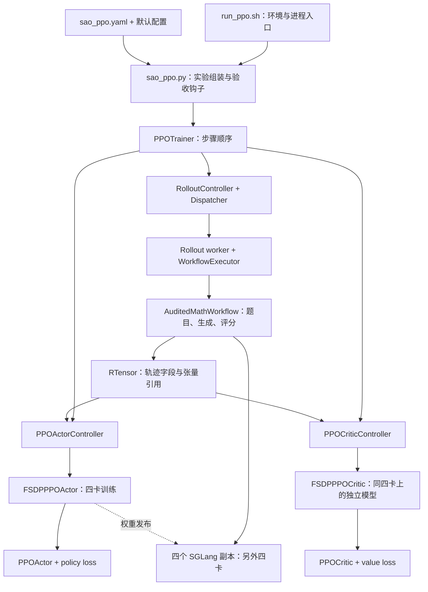
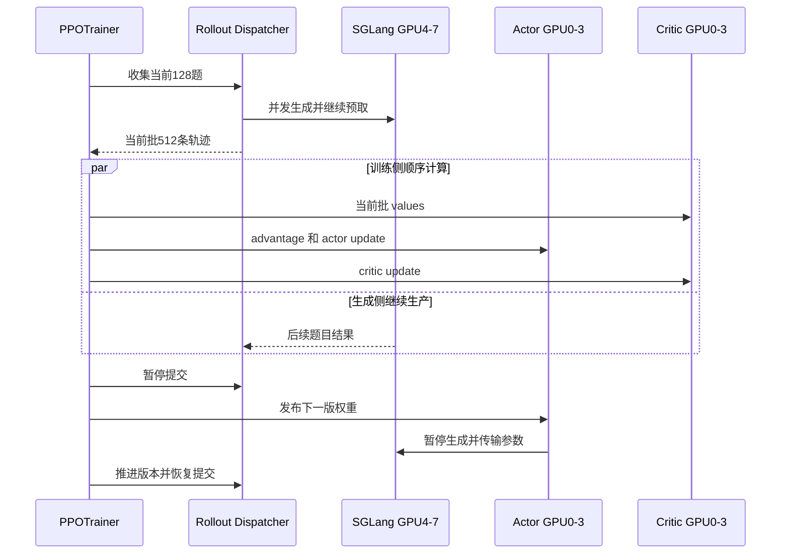

# 从 verl 到 AReaL：沿当前异步 PPO 读懂配置、Rollout、Loss 与 Infra

本文面向熟悉训练任务、尚未读过 AReaL 源码的读者。读完后，你应该能回答：一次更新由谁触发，训练数据在哪里流转，Actor/Critic 各自做什么，要改 Loss
或基础设施时应该进入哪一层。

**当前这套 AReaL 的核心组织方式是：PPOTrainer 编排训练步骤，Controller 调用远程 worker，Engine 执行模型计算，Workflow
定义一次采样与评分，Dispatcher 在后台持续调度 rollout。** Loss 是传给训练 Engine 的计算函数；GPU
分配、数据传输、生成并发和权重同步由不同的基础设施模块负责。

这是一份源码导读，不重新开启逐步监督，也不修改正在运行的实验。历史五步结果只用于说明架构如何在本机落地；完整 epoch 的最新进度不在本文重新验收。

## 0. 阅读边界与路线

### 0.1 本文究竟在解释哪个版本

| 对象                        | 固定范围                                                          | 用途                                              |
| --------------------------- | ----------------------------------------------------------------- | ------------------------------------------------- |
| AReaL 上游基线              | v2.1.0，`ecc8b0e4dfb4e3965f67121a5c87866a07c390ae`                | 区分上游设计与本次适配                            |
| 当前 AReaL 代码             | `63a7a0fa2fba5ee0539a43af4c3f41ef8b8733bf`，分支 `codex/sao-math` | 本文的主线                                        |
| 本地 verl PRD/OPSD worktree | `91cd32042fb706b16a487e9c7110f1d48b00dcef`                        | 解释你之前实际使用的入口和新 V1 架构              |
| 旁边的 verl-v0.9.0 仓库     | `ef748aca3bfceb8964e49d90856766189d616dc3`                        | 仅作版本参照，不与 PRD worktree 混用              |
| 当前运行                    | `ppo-dapo-epoch1-20260921-v2`                                     | Qwen3.5-4B-Base、全量合格 DAPO、8K、4+4、异步 PPO |

源码入口分别为
[AReaL 的 PPOTrainer](/data_storage/yl_test/lgx/data-1/code/_worktrees/AReaL/codex-sao-math/areal/trainer/rl_trainer.py:106)、[verl 的 main_ppo](/data_storage/yl_test/lgx/data-1/code/_worktrees/verl/codex-math-prd-opsd/verl/trainer/main_ppo.py:178)。本机运行事实以
[resolved-config.json](/data_storage/yl_test/lgx/data-1/code/_artifacts/AReaL/codex-sao-math/runs/ppo-dapo-epoch1-20260921-v2/evidence/resolved-config.json)
和
[frozen-run.json](/data_storage/yl_test/lgx/data-1/code/_artifacts/AReaL/codex-sao-math/runs/ppo-dapo-epoch1-20260921-v2/evidence/frozen-run.json)
为准。

> **三个名称不要混用。** AReaL release 是 v2.1.0；当前 `actor._version`、`rollout._version` 都是
> `v1`；目录后缀 `-v2` 表示第二次正式运行。它们不是同一个版本维度。文件名中的 `sao_` 也是项目预留命名，本次跑的仍是 PPO，SAO 尚未实现。

本文所有代码链接使用本机绝对路径和单个行号，适合在当前
Codex/编辑器中点击。迁移到其他机器或未来修改文件后，路径和行号需要同步调整；文中同时写出符号名，方便搜索。它不是对所有历史/未来版本的通用承诺。

### 0.2 建议怎么读

第一次读，顺序看第 1–4 节，建立角色与执行流程；随后看第 5–8 节，理解数据、Loss 和模型。实际动手时，直接查第 9–10
节的修改入口。最后的小练习用来确认自己能定位问题，无需运行 GPU 实验。

## 1. 先对齐 verl 与 AReaL 的概念

### 1.1 Hybrid、异步、FSDP2 解决的是不同问题

这三个词分别回答不同问题：

| 概念                  | 回答的问题                                                    | 本次例子                                                 |
| --------------------- | ------------------------------------------------------------- | -------------------------------------------------------- |
| Hybrid / colocation   | 训练和推理的角色怎样共享或切换 GPU 资源、权重与执行布局       | 你之前的 verl 同步配置会在生成后让 rollout sleep，再训练 |
| 同步 / 异步训练流水线 | 当前 batch 更新时，是否可以生成后续 batch；样本能落后多少版本 | 本次 AReaL 四卡生成后续数据，另四卡训练                  |
| FSDP2                 | 训练侧参数、梯度、优化器状态如何分片和通信                    | 本次 actor 与 critic 都用四卡 FSDP2                      |
| SGLang / vLLM         | 如何高效完成 prefill、decode、KV cache 和请求调度             | 本次 SGLang 四个 TP=1 的推理副本                         |

因此，不能从 `rollout.mode=async` 直接推出“训练与 rollout 已经在 GPU 上并行”。也不能说“用了 Hybrid
就不可能有异步”，或“FSDP2 自带 rollout 引擎”。

你记得的 verl HybridEngine，重点在**训练角色与推理角色的资源复用和执行切换**，不是 Python 类的 override 本身。旧
[RayPPOTrainer 的 hybrid_engine 分支](/data_storage/yl_test/lgx/data-1/code/_worktrees/verl/codex-math-prd-opsd/verl/trainer/ppo/ray_trainer.py:333)
会检查 ActorRollout/ActorRolloutRef 的角色组合；新路径也延续资源和角色组合，但组织层次已有变化。

### 1.2 你之前的 verl PRD 实际走哪条路径

[epoch shell wrapper](/data_storage/yl_test/lgx/data-1/code/_worktrees/verl/codex-math-prd-opsd/examples/on_policy_distillation_trainer/run_qwen35_4b_math_prd_epoch.sh:39)
调用主启动脚本，后者执行
[python -m verl.trainer.main_ppo](/data_storage/yl_test/lgx/data-1/code/_worktrees/verl/codex-math-prd-opsd/examples/on_policy_distillation_trainer/run_qwen35_4b_math_prd.sh:267)。其中显式选择：

- [trainer.use_v1=True / trainer.v1.trainer_mode=sync](/data_storage/yl_test/lgx/data-1/code/_worktrees/verl/codex-math-prd-opsd/examples/on_policy_distillation_trainer/run_qwen35_4b_math_prd.sh:344)：采用新
  V1 Trainer，训练模式为同步；
- [rollout.mode=async](/data_storage/yl_test/lgx/data-1/code/_worktrees/verl/codex-math-prd-opsd/examples/on_policy_distillation_trainer/run_qwen35_4b_math_prd.sh:318)：生成通过异步
  rollout server/client。

这两个配置可以同时成立。[PPOTrainerSync.on_sample_end](/data_storage/yl_test/lgx/data-1/code/_worktrees/verl/codex-math-prd-opsd/verl/trainer/ppo/v1/trainer_sync.py:42)
在采样结束后让推理副本
sleep，[on_step_end](/data_storage/yl_test/lgx/data-1/code/_worktrees/verl/codex-math-prd-opsd/verl/trainer/ppo/v1/trainer_sync.py:35)
再同步更新后的权重。也就是说，生成服务处理请求可以异步，外层训练仍按阶段切换资源。

新 V1 的
[TaskRunnerV1.run](/data_storage/yl_test/lgx/data-1/code/_worktrees/verl/codex-math-prd-opsd/verl/trainer/main_ppo.py:134)
初始化 TransferQueue，创建选定 Trainer 和 AgentLoopManager，再调用 fit。当前 checkout 还提供
[sync / colocate_async / separate_async 三种 Trainer](/data_storage/yl_test/lgx/data-1/code/_worktrees/verl/codex-math-prd-opsd/verl/trainer/ppo/v1/__init__.py:15)；本文不把这些不同模式都归为旧式同步
Hybrid，也不声称它们已在本机分别完成运行验证。

### 1.3 两套系统的对应关系

| 责任               | 本地 verl 新 V1 路径                                | 当前 AReaL v1 Controller 路径                                   |
| ------------------ | --------------------------------------------------- | --------------------------------------------------------------- |
| 实验入口           | Shell → Hydra → main_ppo → TaskRunnerV1             | Shell → sao_ppo.py → PPOConfig → PPOTrainer                     |
| 外层训练编排       | PPOTrainer 基类 + sync/async 子类 hooks             | PPOTrainer.train                                                |
| Worker 组织        | Ray resource pool、RayWorkerGroup、角色 worker      | Scheduler、Job、TrainController / RolloutController、RPC worker |
| 一次采样逻辑       | AgentLoopWorker / 具体 AgentLoop                    | RolloutWorkflow.arun_episode                                    |
| 样本存储和引用     | TransferQueue、ReplayBuffer、KVBatchMeta            | Dispatcher 的任务结果、RTensor shard 引用与 HTTP tensor storage |
| Actor loss 接入    | worker 设置 loss_fn；PPO loss registry 按名字查函数 | PPOActor 绑定 loss callback，交给 FSDPEngine.train_batch        |
| Advantage / return | V1 Trainer 计算并写回 TQ 字段                       | PPOActor.compute_advantages 在训练 worker 中计算                |
| 优化器更新         | TrainingWorker → backend Engine                     | FSDPPPOActor/PPOCritic → FSDPEngine                             |
| 推理权重更新       | checkpoint/weight manager 及具体 transport          | WeightUpdateMeta + Engine + rollout callback；本次为 XCCL/NCCL  |

这些是责任对应，类与类并非一一等价。例如 RTensor 不等于带采样策略的 ReplayBuffer：它主要解决“张量在哪里、怎样拿到”，采样顺序与准入由
Dispatcher 负责。

### 1.4 verl 的旧 DataProto 与新 TransferQueue

旧
[RayPPOTrainer](/data_storage/yl_test/lgx/data-1/code/_worktrees/verl/codex-math-prd-opsd/verl/trainer/ppo/ray_trainer.py:286)
可以理解为 driver 围绕一个 DataProto batch 调用不同 worker，逐步增加 logprob、reward、advantage 等字段。

你当前 PRD checkout 的 V1 路径更偏向传递 **KVBatchMeta 中的样本键与元数据**，真正的数据字段放在
TransferQueue。[AgentLoopWorkerTQ 写入轨迹](/data_storage/yl_test/lgx/data-1/code/_worktrees/verl/codex-math-prd-opsd/verl/trainer/ppo/v1/agent_loop_tq.py:262)
使用 `{uid}_{session_id}_{index}`，分别区分原题、同题采样和一次 agent loop
的输出片段。[ReplayBuffer 的存储说明](/data_storage/yl_test/lgx/data-1/code/_worktrees/verl/codex-math-prd-opsd/verl/trainer/ppo/v1/replay_buffer.py:63)
解释了 tag/value 和 prompt 状态。

`PPOTrainer._step_once` 的普通 PPO 分支读取样本、算 reward/old logprob/value/advantage，随后更新 critic
和 actor；PRD full-vocab 分支会先准备专有训练字段，不能把它直接当成标准 PPO。见
[V1 的一步训练](/data_storage/yl_test/lgx/data-1/code/_worktrees/verl/codex-math-prd-opsd/verl/trainer/ppo/v1/trainer_base.py:617)。

## 2. 一张图看懂本次 AReaL



这张图画的是逻辑责任，不代表每个框恰好一个进程。尤其当前配置的 critic 使用
`colocation(target=actor, fork=true)`：**同卡、独立进程、独立模型、独立优化器**；不是 actor 多加一个 head
后共用梯度。[LocalScheduler 的 fork/复用分支](/data_storage/yl_test/lgx/data-1/code/_worktrees/AReaL/codex-sao-math/areal/infra/scheduler/local.py:701)
决定这件事。

物理布局：

```text
主控制进程：运行 sao_ppo.py / PPOTrainer，发起调度，记录状态

GPU 0—3：
  actor worker 0—3：四卡组成一套 FSDP2 actor
  critic worker 0—3：独立进程，使用同四卡组成另一套 FSDP2 critic
  一步内先 actor 更新，再 critic 更新

GPU 4—7：
  rollout worker 0—3 + SGLang 子进程
  四份完整推理权重，每份 TP=1；并发生成后续样本

评测：
  eval rollout 复用现有 SGLang servers，不另外申请四张 GPU
```

`fsdp:d4p1t1` 的 d/p/t 分别是 data/pipeline/tensor parallel；四个训练 rank 协同分片，不能理解成“四个完全互不相干的
actor”。`sglang:d4p1t1` 在推理侧表示四个独立副本。解析对象见
[ParallelStrategy](/data_storage/yl_test/lgx/data-1/code/_worktrees/AReaL/codex-sao-math/areal/api/alloc_mode.py:33)。

## 3. 从末端训练脚本向上追踪

### 3.1 第一个入口：Shell 负责环境，不负责 PPO 数学

[scripts/sao/run_ppo.sh](/data_storage/yl_test/lgx/data-1/code/_worktrees/AReaL/codex-sao-math/scripts/sao/run_ppo.sh:3)
做三件事：

1. 检查模型、数据、run root、trial name 等环境变量；
1. 加载
   [runtime_env.sh](/data_storage/yl_test/lgx/data-1/code/_worktrees/AReaL/codex-sao-math/scripts/sao/runtime_env.sh:3)
   和项目 .venv；
1. 执行 `python examples/math/sao_ppo.py --config examples/math/sao_ppo.yaml`。

环境脚本负责 CUDA compat、动态库、缓存、离线权重与本机通信环境。它不选择 PPO ratio 公式。遇到 ABI/库加载错误应先查这一层；遇到 policy
clipping 不对，应该继续往算法层找。

已冻结的具体环境入口是
[formal-launch-v2.env](/data_storage/yl_test/lgx/data-1/code/_artifacts/AReaL/codex-sao-math/formal-launch-v2.env)。这是本机实验绑定，不是
AReaL 上游公共配置。

### 3.2 第二个入口：Python 组装实验

[sao_ppo.main](/data_storage/yl_test/lgx/data-1/code/_worktrees/AReaL/codex-sao-math/examples/math/sao_ppo.py:425)
按以下顺序工作：

```text
load_expr_config → validate_contract → 写 resolved config
→ load_from_disk(train/test)
→ 指定 AuditedMathWorkflow 和 reward_fn
→ 构造 PPOTrainer
→ 绑定 finite_epoch、采样种子、审计 hooks
→ 更新前 baseline
→ trainer.train(...)
```

[workflow_kwargs](/data_storage/yl_test/lgx/data-1/code/_worktrees/AReaL/codex-sao-math/examples/math/sao_ppo.py:451)
指定了 reward、tokenizer、gconfig
和样本日志位置。[install_audit_hooks](/data_storage/yl_test/lgx/data-1/code/_worktrees/AReaL/codex-sao-math/examples/math/sao_ppo.py:244)
是本次加的证据层：记录实际消费 ID、终止信息、前五步 return oracle、更新次数和监督收据。**核心 PPO 循环仍由原生 PPOTrainer
执行**，不是这个脚本自己重写一套 optimizer loop。

本次 `validate_contract` 会拒绝改变某些冻结协议的 override，例如 clip、GAE λ 或回答上限。未来开新算法实验时，不能一边修改
YAML，一边保留旧断言却期待它通过；应新建相应入口/协议，并更新受影响验证。

### 3.3 第三个入口：配置继承与最终值

[sao_ppo.yaml 的 defaults](/data_storage/yl_test/lgx/data-1/code/_worktrees/AReaL/codex-sao-math/examples/math/sao_ppo.yaml:1)
先继承
[gsm8k_ppo.yaml](/data_storage/yl_test/lgx/data-1/code/_worktrees/AReaL/codex-sao-math/examples/math/gsm8k_ppo.yaml:1)，再用
`_self_`
覆盖。[parse_cli_args](/data_storage/yl_test/lgx/data-1/code/_worktrees/AReaL/codex-sao-math/areal/api/cli_args.py:3474)
通过 Hydra compose 合并 YAML 与命令行
override；[load_expr_config](/data_storage/yl_test/lgx/data-1/code/_worktrees/AReaL/codex-sao-math/areal/api/cli_args.py:3544)
再转换为结构化 dataclass。

配置应同时读三处：

| 层               | 解决的问题                     | 阅读入口                                                                                                                                                                                                                                                                                                                                               |
| ---------------- | ------------------------------ | ------------------------------------------------------------------------------------------------------------------------------------------------------------------------------------------------------------------------------------------------------------------------------------------------------------------------------------------------------ |
| 本实验 YAML      | 我们主动改了什么               | [sao_ppo.yaml](/data_storage/yl_test/lgx/data-1/code/_worktrees/AReaL/codex-sao-math/examples/math/sao_ppo.yaml:1)                                                                                                                                                                                                                                     |
| 配置类型与默认值 | 字段是什么意思，遗漏时采用什么 | [PPOConfig](/data_storage/yl_test/lgx/data-1/code/_worktrees/AReaL/codex-sao-math/areal/api/cli_args.py:3397)、[PPOActorConfig](/data_storage/yl_test/lgx/data-1/code/_worktrees/AReaL/codex-sao-math/areal/api/cli_args.py:1672)、[PPOCriticConfig](/data_storage/yl_test/lgx/data-1/code/_worktrees/AReaL/codex-sao-math/areal/api/cli_args.py:1990) |
| resolved config  | 本次最终生效的是什么           | [resolved-config.json](/data_storage/yl_test/lgx/data-1/code/_artifacts/AReaL/codex-sao-math/runs/ppo-dapo-epoch1-20260921-v2/evidence/resolved-config.json)                                                                                                                                                                                           |

一个实际例子：上游 gsm8k_ppo 默认启用 recompute、decoupled loss 和 rejection sampling；我们的 YAML
显式关掉。只读默认例子会把本次 PPO 误认成另一种 loss。

### 3.4 配置字段到消费者的导航表

| 你要控制什么          | 当前字段与值                                                                | 它最终在哪里使用                                                                                                                                                                                                                                              |
| --------------------- | --------------------------------------------------------------------------- | ------------------------------------------------------------------------------------------------------------------------------------------------------------------------------------------------------------------------------------------------------------- |
| 训练后端与四卡        | `actor.backend=fsdp:d4p1t1`                                                 | [创建训练 Engine](/data_storage/yl_test/lgx/data-1/code/_worktrees/AReaL/codex-sao-math/areal/trainer/rl_trainer.py:1124)                                                                                                                                     |
| Actor 模型和精度      | `actor.path`、BF16 compute、FP32 optimizer storage                          | [FSDP 模型加载](/data_storage/yl_test/lgx/data-1/code/_worktrees/AReaL/codex-sao-math/areal/engine/fsdp_engine.py:1083)                                                                                                                                       |
| Critic 角色           | `critic.is_critic=true`，同 Base 路径                                       | [创建 critic](/data_storage/yl_test/lgx/data-1/code/_worktrees/AReaL/codex-sao-math/areal/trainer/rl_trainer.py:1151)、[模型类型选择](/data_storage/yl_test/lgx/data-1/code/_worktrees/AReaL/codex-sao-math/areal/engine/fsdp_engine.py:1048)                 |
| Actor / critic 学习率 | `actor.optimizer.lr=1e-6` / `critic.optimizer.lr=5e-6`                      | [优化器构造](/data_storage/yl_test/lgx/data-1/code/_worktrees/AReaL/codex-sao-math/areal/engine/fsdp_engine.py:1208)                                                                                                                                          |
| 策略 clipping         | `actor.eps_clip=0.2`、`eps_clip_higher=null`                                | [PPOActor 绑定 loss callback](/data_storage/yl_test/lgx/data-1/code/_worktrees/AReaL/codex-sao-math/areal/trainer/ppo/actor.py:500)                                                                                                                           |
| Value clipping        | `critic.eps_clip=0.5`                                                       | [critic loss wrapper](/data_storage/yl_test/lgx/data-1/code/_worktrees/AReaL/codex-sao-math/areal/trainer/ppo/critic.py:105)                                                                                                                                  |
| GAE                   | `actor.discount=1`、`gae_lambda=1`、`gae_timestep_unit=token`               | [compute_advantages](/data_storage/yl_test/lgx/data-1/code/_worktrees/AReaL/codex-sao-math/areal/trainer/ppo/actor.py:178)、[token GAE](/data_storage/yl_test/lgx/data-1/code/_worktrees/AReaL/codex-sao-math/areal/trainer/ppo/gae.py:27)                    |
| 采样量和长度          | `gconfig.n_samples=4`、`max_new_tokens=8192`                                | [Trainer 传 group_size](/data_storage/yl_test/lgx/data-1/code/_worktrees/AReaL/codex-sao-math/areal/trainer/rl_trainer.py:699)、[SGLang 请求构造](/data_storage/yl_test/lgx/data-1/code/_worktrees/AReaL/codex-sao-math/areal/engine/sglang_remote.py:54)     |
| Prompt batch          | `train_dataset.batch_size=128`                                              | [dataloader](/data_storage/yl_test/lgx/data-1/code/_worktrees/AReaL/codex-sao-math/areal/trainer/rl_trainer.py:267)、[prepare_batch](/data_storage/yl_test/lgx/data-1/code/_worktrees/AReaL/codex-sao-math/areal/infra/controller/rollout_controller.py:1023) |
| 异步准入              | `max_concurrent_rollouts=128`、`queue_size=256`、`max_head_offpolicyness=2` | [Dispatcher 初始化](/data_storage/yl_test/lgx/data-1/code/_worktrees/AReaL/codex-sao-math/areal/infra/controller/rollout_controller.py:204)                                                                                                                   |
| SGLang 优化           | FlashInfer、CUDA Graph、overlap scheduler                                   | [sglang 配置段](/data_storage/yl_test/lgx/data-1/code/_worktrees/AReaL/codex-sao-math/examples/math/sao_ppo.yaml:137)、[server args 构造](/data_storage/yl_test/lgx/data-1/code/_worktrees/AReaL/codex-sao-math/areal/api/cli_args.py:2258)                   |
| 周期                  | saver/recover/evaluator 每 20 步、epoch 尾步                                | [周期配置](/data_storage/yl_test/lgx/data-1/code/_worktrees/AReaL/codex-sao-math/examples/math/sao_ppo.yaml:173)、[保存/评测主循环](/data_storage/yl_test/lgx/data-1/code/_worktrees/AReaL/codex-sao-math/areal/trainer/rl_trainer.py:899)                    |

其中 `gconfig` 管生成参数，`rollout` 管任务调度与推理引擎关系，`sglang` 管具体服务参数；它们是三层配置，不能互相替代。

## 4. Trainer 如何组织一次 PPO 更新

### 4.1 初始化时谁创建谁

[PPOTrainer.\_init_impl](/data_storage/yl_test/lgx/data-1/code/_worktrees/AReaL/codex-sao-math/areal/trainer/rl_trainer.py:124)
解析模型 allocation、创建 scheduler、训练角色、dataloader、推理角色、权重同步元信息以及保存/评测组件。

在当前 single-controller 模式里，`trainer.actor` 是 **PPOActorController**。它的远端是
**FSDPPPOActor**，后者通过组合持有算法对象 **PPOActor**。三个名字相似，责任不同：

| 对象               | 所在侧                  | 负责的事情                                             |
| ------------------ | ----------------------- | ------------------------------------------------------ |
| PPOTrainer         | 主控制侧                | 顺序、生命周期、保存评测、版本推进                     |
| PPOActorController | 主控制侧                | 分发数据和调用远端方法，汇集结果                       |
| FSDPPPOActor       | GPU worker              | FSDP 模型、优化器、计算接口                            |
| PPOActor           | GPU worker 内的算法对象 | advantage、PPO 参数、loss callback                     |
| FSDPEngine         | GPU worker 的执行基础   | microbatch、forward/backward、梯度缩放、optimizer.step |

创建桥梁见
[FSDPPPOActor.as_controller](/data_storage/yl_test/lgx/data-1/code/_worktrees/AReaL/codex-sao-math/areal/engine/fsdp_engine.py:2391)；组合关系见
[FSDPPPOActor.__init__](/data_storage/yl_test/lgx/data-1/code/_worktrees/AReaL/codex-sao-math/areal/engine/fsdp_engine.py:2322)；RPC
转发见
[PPOActorController](/data_storage/yl_test/lgx/data-1/code/_worktrees/AReaL/codex-sao-math/areal/trainer/ppo/actor.py:524)。

### 4.2 一步不是一句 train_batch

沿
[PPOTrainer.train](/data_storage/yl_test/lgx/data-1/code/_worktrees/AReaL/codex-sao-math/areal/trainer/rl_trainer.py:640)，本次生效路径可以简化为：

```python
batch = actor.prepare_batch(dataloader, workflow, group_size=4)
batch["values"] = critic.compute_values(batch)
# ref / teacher / prox-logprob 重算在本次配置下跳过
adv_batch = actor.compute_advantages(batch)
actor.ppo_update(adv_batch)
critic.ppo_update(adv_batch)
rollout.pause()
actor.update_weights(version=global_step + 1)
actor.set_version(...); critic.set_version(...); rollout.set_version(...)
save_if_due()
evaluate_if_due()
clear_remote_batches()
commit_stats_and_supervise_if_first_five()
rollout.resume()
```

这是帮助阅读的伪代码；实际 batch 是 list of trajectory dict，部分字段是 RTensor，而不是单个普通 dict。

注意：本次先计算旧 critic values，再算固定的 advantage/return；actor 更新后，critic 用同一批 return 训练。**critic
并没有在 actor 每个 microbatch 之后重新产生 target。** 实际调用点分别是
[compute_values](/data_storage/yl_test/lgx/data-1/code/_worktrees/AReaL/codex-sao-math/areal/trainer/rl_trainer.py:723)、[compute_advantages](/data_storage/yl_test/lgx/data-1/code/_worktrees/AReaL/codex-sao-math/areal/trainer/rl_trainer.py:806)、[actor update](/data_storage/yl_test/lgx/data-1/code/_worktrees/AReaL/codex-sao-math/areal/trainer/rl_trainer.py:826)、[critic update](/data_storage/yl_test/lgx/data-1/code/_worktrees/AReaL/codex-sao-math/areal/trainer/rl_trainer.py:851)。

### 4.3 主循环顺序执行，为什么仍然异步



`prepare_batch` 收到足够结果便把当前 batch 返回；后台 Dispatcher/async runner 并不因此销毁。训练卡工作期间，推理卡可以生成未来
batch。这就是本次“异步 PPO”的关键。

异步不代表每一毫秒都八卡满载。预取窗口耗尽、权重更新、评测或监督暂停时，推理端会等待。证明异步需要同一运行的 GPU
时间证据；本次已完成的五步中，[原始 GPU 算子重叠记录](/data_storage/yl_test/lgx/data-1/code/_artifacts/AReaL/codex-sao-math/runs/ppo-dapo-epoch1-20260921-v2/evidence/profiler/raw-kernel-witness-1.json)
确实出现 actor 计算与 SGLang GDN 解码交叠，但它不能给出完整训练的加速倍数。

## 5. Channel：控制、样本、张量、权重走不同通路

用户提到的 Channel，本文按“组件间通信通路”解释。在这两个 checkout 的所选训练主路径里，没有找到一个统一叫 `Channel`
的核心类统管所有通信。查问题时，更有用的是先确定“正在传什么”。

| 通路         | AReaL 当前实现                                    | 本地 verl 的对应位置                                     | 常见问题                                   |
| ------------ | ------------------------------------------------- | -------------------------------------------------------- | ------------------------------------------ |
| 控制命令     | Controller → Scheduler → HTTP RPC `/call`         | Ray Actor / RayWorkerGroup 方法调用                      | worker 未就绪、RPC 超时、rank 调用顺序错误 |
| 样本任务     | Dispatcher、WorkflowExecutor、AsyncTaskRunner     | AgentLoopManager、ReplayBuffer、TransferQueue 的状态/tag | 卡住等样本、准入不足、失败题被替换         |
| 张量数据     | RTensor 引用，HTTP `/data/*`，进程内 fetch buffer | 旧 DataProto；新 KVBatchMeta 指向 TQ 中的字段            | 数据缺字段、形状错误、缓存未释放           |
| 推理权重     | WeightUpdateMeta、XCCL/NCCL、rollout callback     | checkpoint/weight manager 与选定 transport               | 参数名/精度不匹配、更新版本未推进          |
| 训练集体通信 | FSDP2 process group、all-gather/reduce 等         | verl 后端 Engine 的 FSDP/Megatron 通信                   | rank 缺席、梯度归约不一致                  |

最后两行都可能使用 NCCL，但不是同一个目的：训练卡之间的梯度通信，和训练模型向推理副本发布参数，需要分别追踪。

### 5.1 控制通路：看起来像本地方法，实际上要跨进程

调用 `trainer.actor.ppo_update(batch)` 后：

```text
PPOActorController.ppo_update
→ TrainController._custom_function_call
→ 按 DP 组分发输入，向所有必要 rank 发 RPC
→ LocalScheduler.async_call_engine
→ worker 的 /call endpoint
→ FSDPPPOActor.ppo_update
```

入口链接：[Controller 转发](/data_storage/yl_test/lgx/data-1/code/_worktrees/AReaL/codex-sao-math/areal/trainer/ppo/actor.py:535)
→
[分发与回收](/data_storage/yl_test/lgx/data-1/code/_worktrees/AReaL/codex-sao-math/areal/infra/controller/train_controller.py:471)
→
[DP 分片](/data_storage/yl_test/lgx/data-1/code/_worktrees/AReaL/codex-sao-math/areal/infra/controller/train_controller.py:526)
→
[RPC 发送](/data_storage/yl_test/lgx/data-1/code/_worktrees/AReaL/codex-sao-math/areal/infra/scheduler/local.py:1543)
→
[worker /call](/data_storage/yl_test/lgx/data-1/code/_worktrees/AReaL/codex-sao-math/areal/infra/rpc/guard/engine_blueprint.py:425)。

Controller 传 `broadcast=True` 不意味着所有 DP rank 都吃同一批全部样本：输入先按 DP 分组切分；后续广播语义还需要结合 worker
内的执行方式读。不要仅从参数名推导 batch 是否重复。

worker 的
[engine thread](/data_storage/yl_test/lgx/data-1/code/_worktrees/AReaL/codex-sao-math/areal/infra/rpc/guard/engine_blueprint.py:115)
串行执行相关 Engine 操作，以维护 NCCL 调用一致性；数据端点可以另外并发处理。因此“RPC 层异步”也不等于“一个 Engine 内可以随意多线程并发
optimizer”。

### 5.2 张量通路：RTensor 是远程引用，不是另一种数学张量算法

[RTensor](/data_storage/yl_test/lgx/data-1/code/_worktrees/AReaL/codex-sao-math/areal/infra/rpc/rtensor.py:351)
可以携带 shard 信息与 meta tensor。控制端能看见形状和引用，不必每次都把完整 token 张量搬回主进程。消费者通过 `to_local` /
`localize` 获取真实数据；当前默认
[HttpRTensorBackend](/data_storage/yl_test/lgx/data-1/code/_worktrees/AReaL/codex-sao-math/areal/infra/rpc/rtensor.py:87)
访问远端 shard。

这与 verl 新路径“传元数据、按需取 tensor”的思想相似，但存储接口和生命周期不同。RTensor 的
[fetch buffer](/data_storage/yl_test/lgx/data-1/code/_worktrees/AReaL/codex-sao-math/areal/infra/rpc/rtensor.py:287)
是**进程私有**的；删除 storage-owner 上的 shard，不会自动清理另一个消费者进程的缓存。Trainer 所以在步末向 actor、critic
等相关角色分别发 clear。查
[clear_batches 调用](/data_storage/yl_test/lgx/data-1/code/_worktrees/AReaL/codex-sao-math/areal/trainer/rl_trainer.py:938)
时，要同时想清楚生产者和消费者各持有什么。

### 5.3 样本通路：128 是题目数，512 才是回答数

当前一条 dataset row 是一道题。Controller 分发它时附带
`group_size=4`；[GroupedRolloutWorkflow](/data_storage/yl_test/lgx/data-1/code/_worktrees/AReaL/codex-sao-math/areal/infra/remote_inf_engine.py:70)
并发调用四次基础 workflow，每次获得一个回答和 reward，再按 sample_idx 组织结果。

所以
[RLVRWorkflow 构造 n_samples=1 的请求](/data_storage/yl_test/lgx/data-1/code/_worktrees/AReaL/codex-sao-math/areal/workflow/rlvr.py:154)
是合理的：外层已负责四次采样；内层每个请求只生成一条。不要把两层都乘 4。

| 层次                      | 本次单位                      |     数量 |
| ------------------------- | ----------------------------- | -------: |
| Dataset / consumer batch  | 题目 / prompt group           |      128 |
| Grouped workflow          | 同题回答                      |        4 |
| 一次普通联合更新          | trajectories                  |      512 |
| 四卡 DP 均分后的样本量    | 每个训练 rank 的 trajectories | 通常 128 |
| Qwen3.5 Engine microbatch | 独立序列                      |        1 |
| 最后一个训练 batch        | 5 题 × 4 回答                 |       20 |

`ppo_n_minibatches=1` 表示这一批只分一个算法 minibatch，各角色只做一次 optimizer update；这不表示 forward 只跑一个
GPU microbatch。Engine 为显存和序列隔离还会再拆分。

### 5.4 StalenessManager 怎样限制“跑得太超前”

[get_pending_limit](/data_storage/yl_test/lgx/data-1/code/_worktrees/AReaL/codex-sao-math/areal/infra/staleness_manager.py:69)
给出：

```text
pending limit = (max_staleness + 1) × consumer_batch_size
              = (2 + 1) × 128 = 384 个题目任务
```

真正的提交 capacity 还取两种约束的最小值，见
[get_capacity](/data_storage/yl_test/lgx/data-1/code/_worktrees/AReaL/codex-sao-math/areal/infra/staleness_manager.py:99)：

```text
并发余量 = max_concurrent_rollouts - running
版本窗口余量 = (max_staleness + current_version + 1)
               × consumer_batch_size - (accepted + running)
```

Dispatcher 还要检查 runner queue 的剩余容量。故 384、128、256 各自属于不同计数，不能把 `queue_size=256`
当成“所有进行中与已完成样本加起来最多 256”。

它主要通过**限制准入**控制陈旧度，而不是等训练时才简单丢掉旧样本。排查时同时看 submitted/running/accepted、消费者版本与每 token
的行为版本；不要为了让吞吐变好就无限扩大预取窗口。当前五步实测最大滞后 2，是
[样本与版本总账](/data_storage/yl_test/lgx/data-1/code/_artifacts/AReaL/codex-sao-math/runs/ppo-dapo-epoch1-20260921-v2/evidence/audit-step5.json)
的运行结论，不仅来自配置值。

### 5.5 权重通路：两种 pause 和逐 token 版本

需要区分：

- [RolloutController.pause](/data_storage/yl_test/lgx/data-1/code/_worktrees/AReaL/codex-sao-math/areal/infra/controller/rollout_controller.py:1194)：暂停
  Dispatcher/worker 的任务提交；
- [RemoteInfEngine.pause_generation](/data_storage/yl_test/lgx/data-1/code/_worktrees/AReaL/codex-sao-math/areal/infra/remote_inf_engine.py:1399)：向具体推理服务发暂停请求，用于安全更新权重。

当前 `actor.weight_update_mode=xccl`，不是 AWEX/delta
或磁盘中转。[FSDPEngine.\_update_weights_from_distributed](/data_storage/yl_test/lgx/data-1/code/_worktrees/AReaL/codex-sao-math/areal/engine/fsdp_engine.py:1654)
收集分片参数并按 bucket 传输；训练 rank0 协调推理暂停/恢复。成功后 Trainer 再推进 actor、critic、rollout 的版本。

在可中断并续接的生成路径里，一条回答可以跨多个权重版本。[请求段版本固定](/data_storage/yl_test/lgx/data-1/code/_worktrees/AReaL/codex-sao-math/areal/infra/remote_inf_engine.py:966)
和
[accumulated_versions](/data_storage/yl_test/lgx/data-1/code/_worktrees/AReaL/codex-sao-math/areal/infra/remote_inf_engine.py:1011)
会逐段记录实际生成版本，再扩展到每个 token。因此训练数据用 `versions[B,L]`，不能随手改成一个 batch
级的版本数字。这里描述的是源码支持的机制，不意味着我们的每条轨迹都实际发生过跨版本续接。

## 6. Rollout 是怎样变成可训练张量的

### 6.1 Workflow、推理 Engine、reward 各负责什么

[RLVRWorkflow.arun_episode](/data_storage/yl_test/lgx/data-1/code/_worktrees/AReaL/codex-sao-math/areal/workflow/rlvr.py:141)
拿到题目，构造 prompt token、调用
`engine.agenerate`，再调用评分器。[AuditedMathWorkflow](/data_storage/yl_test/lgx/data-1/code/_worktrees/AReaL/codex-sao-math/areal/workflow/sao_math.py:27)
继承它，增加严格异常处理、显式终止标记和每条样本证据。

具体推理协议由
[SGLangBackend.build_generation_request](/data_storage/yl_test/lgx/data-1/code/_worktrees/AReaL/codex-sao-math/areal/engine/sglang_remote.py:54)
构造 `/generate`
payload，[parse_generation_response](/data_storage/yl_test/lgx/data-1/code/_worktrees/AReaL/codex-sao-math/areal/engine/sglang_remote.py:104)
提取 token、logprob 和停止原因。工作流不需要直接管理 KV cache，也不应该直接做 optimizer.step。

评分调用链是：

```text
AuditedMathWorkflow / RLVRWorkflow._compute_rewards
→ AsyncRewardWrapper
→ math_prd_reward_fn
→ boxed/正则规范化 + LaTeX 语义核验
→ 一个标量 reward
```

见
[reward wrapper](/data_storage/yl_test/lgx/data-1/code/_worktrees/AReaL/codex-sao-math/areal/api/reward_api.py:62)
与
[math_prd_reward_fn](/data_storage/yl_test/lgx/data-1/code/_worktrees/AReaL/codex-sao-math/areal/reward/math_prd.py:449)。格式错/答错和评分基础设施异常要分开：前者按既定评分契约得到
0，后者在本任务严格模式下抛错。reward=0 本身不是“样本应被丢弃”的理由。

### 6.2 训练字段的生命周期

单条完整序列长度记为 L，含 prompt 和 response。组装/拼 batch 后，概念上可以按 B×L 理解；Engine 内部还可能转成 packed 一维
token 布局。

| 字段                                    | 谁产生                              | 谁使用                              | 为什么重要                        |
| --------------------------------------- | ----------------------------------- | ----------------------------------- | --------------------------------- |
| input_ids / attention_mask              | Workflow                            | 模型 forward、真实长度计算          | padding 不应冒充真实 token        |
| loss_mask                               | Workflow，Actor 做 next-token shift | actor/critic loss、归一化           | prompt 与 padding 不参与回答 loss |
| logprobs                                | 推理后端产生行为 logprob            | PPO ratio 的旧策略分母              | 要对应实际生成 token 与温度       |
| versions                                | 推理 Engine                         | 异步滞后审计/算法选项               | 记录每 token 行为版本             |
| rewards                                 | scorer                              | advantage/return 构造               | 本次二值数学 reward               |
| terminated / truncated                  | 实际 stop reason                    | bootstrap 选择                      | 正常结束和长度截断语义不同        |
| values                                  | critic.compute_values               | GAE、critic clipping 中的 old value | 计算 target 时冻结的旧预测        |
| advantages / returns                    | PPOActor.compute_advantages         | actor loss / critic loss            | 两个训练目标各自的输入            |
| audit_source_key / task_id / sample_idx | 本地审计 Workflow                   | 消费记录关联                        | 证明训练实际用了哪些轨迹          |

张量构造见
[RLVR 返回字典](/data_storage/yl_test/lgx/data-1/code/_worktrees/AReaL/codex-sao-math/areal/workflow/rlvr.py:166)，审计字段见
[AuditedMathWorkflow.arun_episode](/data_storage/yl_test/lgx/data-1/code/_worktrees/AReaL/codex-sao-math/areal/workflow/sao_math.py:54)。

### 6.3 为什么 mask 要移动一位

自回归模型在位置 t 的 logits 预测位置 t+1 的 token。假设输入是：

```text
input_ids:        P0 P1 R0 R1 EOS
原 loss_mask:     0  0  1  1   1
对齐预测后 mask:  0  1  1  1   0
```

P1 位置的 logits 预测 R0，因而应该参与回答 loss；最后一个位置没有本序列内的“下一个 token”，不参与 loss。行为 logprob
也必须与此对齐。代码是
[mask 和 logprob shift](/data_storage/yl_test/lgx/data-1/code/_worktrees/AReaL/codex-sao-math/areal/trainer/ppo/actor.py:214)，Engine
的 logits→logprob 在
[\_compute_logprobs_entropy](/data_storage/yl_test/lgx/data-1/code/_worktrees/AReaL/codex-sao-math/areal/engine/fsdp_engine.py:2141)。

修改 response-only 计算、packing、mask 或截断时，要追踪**同一个 token 在整个链条中的位置**。只看最后一个 loss
公式，很难发现这种一位偏移。

## 7. 查 Loss：沿三层走，不只搜一个文件名

### 7.1 三层分别是什么

```text
算法准备层：PPOActor._compute_advantages
  决定 rewards、values、mask 如何变成 advantages / returns

Loss 适配层：actor.grpo_loss_fn 或 critic.ppo_loss_fn
  从 batch 取字段、选择 loss 分支、绑定超参数、记录统计

数学函数层：functional.ppo_actor_loss_fn / ppo_critic_loss_fn
  计算 ratio、clipping、masked loss

执行层：FSDPEngine.train_batch
  forward → 回调算 loss → 缩放 → backward → optimizer.step
```

“我想改 Loss”有时实际是在改第一层，如 GAE、reward shaping、终止 bootstrap；有时是在改数学函数，如 clip
surrogate；有时是在改执行层，如跨 rank 梯度缩放。先分清意图，才能避免改错位置。

### 7.2 Actor 的真实调用链

| 顺序 | 符号                                                                                                                                           | 用途                                 |
| ---- | ---------------------------------------------------------------------------------------------------------------------------------------------- | ------------------------------------ |
| 1    | [PPOTrainer.train → actor.ppo_update](/data_storage/yl_test/lgx/data-1/code/_worktrees/AReaL/codex-sao-math/areal/trainer/rl_trainer.py:826)   | 控制端发起更新                       |
| 2    | [PPOActorController.ppo_update](/data_storage/yl_test/lgx/data-1/code/_worktrees/AReaL/codex-sao-math/areal/trainer/ppo/actor.py:535)          | 跨进程 RPC                           |
| 3    | [FSDPPPOActor.ppo_update](/data_storage/yl_test/lgx/data-1/code/_worktrees/AReaL/codex-sao-math/areal/engine/fsdp_engine.py:2339)              | 转给算法对象                         |
| 4    | [PPOActor.\_ppo_update](/data_storage/yl_test/lgx/data-1/code/_worktrees/AReaL/codex-sao-math/areal/trainer/ppo/actor.py:396)                  | 分算法 minibatch，构造 loss callback |
| 5    | [FSDPEngine.train_batch](/data_storage/yl_test/lgx/data-1/code/_worktrees/AReaL/codex-sao-math/areal/engine/fsdp_engine.py:818)                | 模型 forward 与训练执行              |
| 6    | [actor.grpo_loss_fn](/data_storage/yl_test/lgx/data-1/code/_worktrees/AReaL/codex-sao-math/areal/trainer/ppo/actor.py:564)                     | 取字段，选择 PPO/SAPO/CISPO 分支     |
| 7    | [functional.ppo_actor_loss_fn](/data_storage/yl_test/lgx/data-1/code/_worktrees/AReaL/codex-sao-math/areal/utils/functional/functional.py:452) | 核心 PPO 数学                        |

`grpo_loss_fn` 是历史/复用命名，**当前 PPO 也用它**。决定算法的是：本次有真实 critic，advantages 来自
GAE，reward/group normalization 关闭，ratio 使用行为 logprob，对称 clipping，非 decoupled loss。N=4
只是同题采样次数，不会自动把 PPO 变成 GRPO。

源码里的 **SAPO** 和用户计划的 **SAO** 名称也不同。不要看到 `use_sapo_loss` 就认为本次未来的 SAO 已经有实现。

### 7.3 当前 Actor loss 到底在算什么

对有效 response token，设：

- ℓθ：当前 actor forward 算出的 logprob；
- ℓb：生成该 token 时的行为策略 logprob；
- A：GAE 得到、并按 batch 标准化后的 advantage；
- m：对齐后的 loss mask。

本次关闭 decoupled/recompute，因此 proximal logprob 与行为 logprob
相同。[Actor 选择 old/prox logprob](/data_storage/yl_test/lgx/data-1/code/_worktrees/AReaL/codex-sao-math/areal/trainer/ppo/actor.py:228)
把推理 logprob
放入对应字段；[should_compute_prox_logp](/data_storage/yl_test/lgx/data-1/code/_worktrees/AReaL/codex-sao-math/areal/api/cli_args.py:1861)
使本次跳过额外重算。

公式为：

$$ r_t = \\exp(\\ell\_{\\theta,t} - \\ell\_{b,t}) $$

$$ L\_{\\pi} = \\frac{\\sum_t m_t \\max\\left(-A_t r_t,;
-A_t\\operatorname{clip}(r_t,0.8,1.2)\\right)} {\\sum_t m_t} $$

这里 `max` 来自把最大化的 clipped objective 写成最小化 loss。正负 advantage 在 clip 两侧的行为不同，不能简单理解为“ratio
超出范围就统一置零”。

[ratio 与 clipped surrogate](/data_storage/yl_test/lgx/data-1/code/_worktrees/AReaL/codex-sao-math/areal/utils/functional/functional.py:536)
实现这部分。当前没有 teacher 蒸馏项、没有 reference KL reward、没有 overlong penalty、没有 rejection
sampling；这由配置确定，而不是因为 AReaL 不支持这些功能。loss 中仍会输出 approximate KL/entropy
等统计，**统计项存在不代表它加入了优化目标**。特别是当前 wrapper 对 entropy 做 detach，不能仅凭日志中的 entropy 推断存在 entropy
bonus。

### 7.4 Advantage / return 与终止语义

critic 给出当前轨迹每个状态的
V，[token GAE](/data_storage/yl_test/lgx/data-1/code/_worktrees/AReaL/codex-sao-math/areal/trainer/ppo/gae.py:27)
反向递推：

$$ \\delta_t = r_t + \\gamma V\_{t+1} - V_t,\\qquad A_t = \\delta_t + \\gamma\\lambda
A\_{t+1},\\qquad R_t = A_t + V_t. $$

本次 reward 主要放在最后一个 response action 对应位置，γ=λ=1。对有效状态：

- 正常 EOS 结束：最后 bootstrap=0，return 等于该轨迹的最终 reward；
- 达到 8K 人工时间上限：按已选协议以真实最后状态的 value bootstrap，return 为 reward + Vfinal。

[真实终止标记与 bootstrap](/data_storage/yl_test/lgx/data-1/code/_worktrees/AReaL/codex-sao-math/areal/trainer/ppo/actor.py:250)
决定哪个分支；[保存 returns，再标准化 advantages](/data_storage/yl_test/lgx/data-1/code/_worktrees/AReaL/codex-sao-math/areal/trainer/ppo/actor.py:334)
保证 critic target 不会被 actor 的 advantage normalization 一并改掉。

这是任务协议中的“人工时间上限继续价值”解释，不是说所有长度截断任务都必须 bootstrap。若将 8K 定义为环境真正终止，数学目标就不同，必须整体改协议和验证。

本次曾发现 padding 宽度影响 return 的错误。因此查 value loss 时，先确认 **target 从哪里来**；公式再正确，也无法补救错误
target。回归入口是
[同轨迹不同 padding 的独立测试](/data_storage/yl_test/lgx/data-1/code/_worktrees/AReaL/codex-sao-math/tests/test_sao_termination_contract.py:209)。

### 7.5 Critic loss 与 Actor loss 独立

[PPOCritic.\_ppo_update](/data_storage/yl_test/lgx/data-1/code/_worktrees/AReaL/codex-sao-math/areal/trainer/ppo/critic.py:47)
绑定
[critic.ppo_loss_fn](/data_storage/yl_test/lgx/data-1/code/_worktrees/AReaL/codex-sao-math/areal/trainer/ppo/critic.py:105)，再调用
[functional.ppo_critic_loss_fn](/data_storage/yl_test/lgx/data-1/code/_worktrees/AReaL/codex-sao-math/areal/utils/functional/functional.py:869)。

设 Vold 是更新前预测，Vnew 是本次 forward 输出，R 是固定 target：

$$
V\_{\\mathrm{clip}}=V\_{\\mathrm{old}}+\\operatorname{clip}(V\_{\\mathrm{new}}-V\_{\\mathrm{old}},-0.5,0.5)
$$

$$ L_V=\\operatorname{masked_mean}
\\left\[\\max\\left(\\tfrac12(V\_{\\mathrm{new}}-R)^2,;
\\tfrac12(V\_{\\mathrm{clip}}-R)^2\\right)\\right\]. $$

这里 critic 的 `eps_clip=0.5` 是 **value 差值的范围**，不是 actor 的概率 ratio ±20%。二者不能因为同名字段就用同一种含义。

### 7.6 Loss 算完以后，谁负责梯度和优化器

[FSDPEngine.train_batch](/data_storage/yl_test/lgx/data-1/code/_worktrees/AReaL/codex-sao-math/areal/engine/fsdp_engine.py:818)
先清梯度、拆 Engine microbatch，求全局有效 token 数，再逐个 forward/backward，最后一次 optimizer.step。

关键归一化：

```text
每个 microbatch 的 masked mean loss
× 当前 microbatch 有效 token 数 / 全 DP 有效 token 总数
× DP size
→ backward
```

最后的 DP size 与分布式梯度平均配套。分母来自
[compute_total_loss_weight](/data_storage/yl_test/lgx/data-1/code/_worktrees/AReaL/codex-sao-math/areal/engine/core/train_engine.py:30)
的 all-reduce；缩放见
[\_compute_logprobs_and_loss](/data_storage/yl_test/lgx/data-1/code/_worktrees/AReaL/codex-sao-math/areal/engine/fsdp_engine.py:2281)。如果你把数学
loss 从 token mean 改成 sequence mean，却不调整权重函数和分母，就会悄悄改变长短回答的梯度权重。

真正的 `loss.backward()` 在
[forward_backward_batch](/data_storage/yl_test/lgx/data-1/code/_worktrees/AReaL/codex-sao-math/areal/engine/fsdp_engine.py:804)；梯度裁剪、跳过非有限梯度、optimizer
step 在
[optimizer_step](/data_storage/yl_test/lgx/data-1/code/_worktrees/AReaL/codex-sao-math/areal/engine/fsdp_engine.py:720)。因此
`actor_loss≈0` 不证明未学习，尤其 batch 标准化 advantage 后均值可以很小；应该同时检查梯度和成功更新计数。

### 7.7 与 verl 改 loss 的习惯如何对应

本地 verl 的
[Actor worker loss 选择](/data_storage/yl_test/lgx/data-1/code/_worktrees/verl/codex-math-prd-opsd/verl/workers/engine_workers.py:696)
按是否启用 distillation 选择 `distillation_ppo_loss` 或 `ppo_loss`。普通
[ppo_loss](/data_storage/yl_test/lgx/data-1/code/_worktrees/verl/codex-math-prd-opsd/verl/workers/utils/losses.py:101)
根据 `policy_loss.loss_mode` 调
[get_policy_loss_fn](/data_storage/yl_test/lgx/data-1/code/_worktrees/verl/codex-math-prd-opsd/verl/trainer/ppo/core_algos.py:70)；PRD/OPSD
则有自己的
[distillation loss registry](/data_storage/yl_test/lgx/data-1/code/_worktrees/verl/codex-math-prd-opsd/verl/trainer/distillation/losses.py:624)。

AReaL 当前这条路径是 PPOActor 直接构造 `functools.partial(grpo_loss_fn, ...)`，wrapper 再选择
functional 分支。**不要把 verl 的 loss registry 名称直接填进 AReaL YAML，期待它自动生效。** 在 AReaL
中增加一种目标，通常需要明确增加字段和 callback 分支，或为新算法提供专用算法对象/Engine 适配，并验证它确实被选中。

## 8. Actor、Critic 和 Qwen3.5 加速在哪一层

### 8.1 同一个 Base 路径，不等于同一个模型对象

本次 actor 与 critic 都从本地 Qwen3.5-4B-Base 初始化；之后独立训练：

| 对象   | 输出                    | 优化目的                      | 推理端需要它吗                |
| ------ | ----------------------- | ----------------------------- | ----------------------------- |
| Actor  | 每位置的词表 logits     | 增加有正 advantage 的动作概率 | 是；向 SGLang 发布 actor 权重 |
| Critic | 每位置一个 scalar value | 拟合 return                   | 否；只在训练侧使用            |

Qwen3.5 是复合模型配置，actor 在当前路径由
[\_create_device_model 的多模态模型分支](/data_storage/yl_test/lgx/data-1/code/_worktrees/AReaL/codex-sao-math/areal/engine/fsdp_engine.py:1123)
加载；本次只提供文本数据。不能仅凭任务是纯文本，就断言实际加载类一定是 AutoModelForCausalLM。

Critic 则走本地适配的
[Qwen35TokenCriticForCausalBackbone](/data_storage/yl_test/lgx/data-1/code/_worktrees/AReaL/codex-sao-math/areal/models/transformers/token_critic.py:36)：保留文本骨干，附加
`Linear(hidden_size,1)`。新初始化的是 value head；并非整个 critic
随机初始化。[from_pretrained 的键检查](/data_storage/yl_test/lgx/data-1/code/_worktrees/AReaL/codex-sao-math/areal/models/transformers/token_critic.py:70)
只对白名单中的 head/有意排除部分放行，缺失文本骨干权重会报错。

它将 scalar values 放在模型输出的 `logits` 字段中以复用 Engine 接口。这里的 logits 最后一维是 1，语义是
value，不是词表分布。[\_extract_model_forward_output](/data_storage/yl_test/lgx/data-1/code/_worktrees/AReaL/codex-sao-math/areal/engine/fsdp_engine.py:808)
检查形状，critic wrapper 再 squeeze 和转 FP32 算 loss。

### 8.2 FSDP2 不负责发明 FLA 或卷积 kernel

FSDP2 负责分片、混合精度与分布式训练执行；具体 Gated DeltaNet、卷积、full attention 的实现由模型与算子库选择。

训练侧可继续追到锁定环境中：

- [Transformers Qwen3.5 的 FLA/causal-conv 导入](/data_storage/yl_test/lgx/data-1/code/_worktrees/AReaL/codex-sao-math/.venv/lib/python3.12/site-packages/transformers/models/qwen3_5/modeling_qwen3_5.py:54)；
- [Qwen3_5GatedDeltaNet 的 fast-path 选择](/data_storage/yl_test/lgx/data-1/code/_worktrees/AReaL/codex-sao-math/.venv/lib/python3.12/site-packages/transformers/models/qwen3_5/modeling_qwen3_5.py:495)；
- [训练时 chunk Gated DeltaNet 调用](/data_storage/yl_test/lgx/data-1/code/_worktrees/AReaL/codex-sao-math/.venv/lib/python3.12/site-packages/transformers/models/qwen3_5/modeling_qwen3_5.py:593)。

这些是安装依赖中的代码位置，绑定本文的 Transformers 5.3.0，重建环境升级版本后行号可能改变。SGLang 则有独立的
[Qwen3.5 推理模型实现](/data_storage/yl_test/lgx/data-1/code/_worktrees/AReaL/codex-sao-math/.venv/lib/python3.12/site-packages/sglang/srt/models/qwen3_5.py:109)。两端可以使用相同算子家族，但不能认为
FSDP 端启用就自动证明 SGLang 端也启用，或二者逐位数值完全一致。

本次模型有 24 层线性注意力、8 层 full attention；不是“24 层 Linear Full Attention”。前者用 Gated
DeltaNet，后者才是传统全注意力。训练选择 FA2，推理选择 FlashInfer，这是不同执行端的明确配置。

### 8.3 为什么我们的 microbatch 固定为单序列

一些注意力实现支持通过 cu_seqlens 隔离 packed 序列，但这不保证所有线性状态递推和卷积都会遵守相同边界。

本地
[\_prepare_mb_list 的 Qwen3.5 特殊处理](/data_storage/yl_test/lgx/data-1/code/_worktrees/AReaL/codex-sao-math/areal/engine/fsdp_engine.py:2004)
将每个真实序列独立为 microbatch，再进入后续布局处理，防止题目 A 的状态泄漏到题目 B。它仍使用 FLA/FA2，不等于关闭加速。

代价是不能随意通过合并短序列增加吞吐。未来想恢复 packing，应先证明批处理结果与逐条独立结果一致，覆盖
forward、logprob/value、loss/梯度，再谈速度。已有
[序列隔离测试](/data_storage/yl_test/lgx/data-1/code/_worktrees/AReaL/codex-sao-math/tests/test_sao_sequence_isolation.py:151)
可以作为起点。

## 9. 要改 Loss 或实验目标，按这个顺序操作

本节是未来修改方法，不是要求现在编辑正在运行的冻结候选。新实验应放在独立分支/worktree，使用新的 run root；先沿本文定位消费者，再做最小改动。

### 9.1 先判断改动属于哪种责任

| 你的目标                   | 优先修改位置                           | 还必须联动检查                                      |
| -------------------------- | -------------------------------------- | --------------------------------------------------- |
| 调学习率、clip、GAE λ      | 实验 YAML                              | 配置 dataclass、resolved config、入口协议断言       |
| 更换数学评分规则           | reward_fn 与 Workflow 参数             | 异常/超时边界、boxed/LaTeX 测试、数据 gold          |
| 改 GAE / return / 截断解释 | PPOActor.\_compute_advantages + gae.py | Workflow 的终止/结构字段、critic target、shift      |
| 新增 policy surrogate      | actor wrapper + functional 数学函数    | callback 实际选择、正负 A 梯度、mask、统计字段      |
| 改 value loss              | critic wrapper + ppo_critic_loss_fn    | old value 与 target 固定、value clipping、head 梯度 |
| 改 token/sequence 聚合     | loss 数学 + loss_weight_fn             | DP/microbatch 全局归一化，不能只改 mean             |
| 改 Actor/Critic 更新比例   | PPOTrainer 的步骤安排或专用 Trainer    | version、optimizer 计数、LR scheduler、保存频次     |
| 实现未来 SAO               | 先写清算法协议，再分解到上述层         | 不用某个同名/近似名开关代替算法实现                 |

### 9.2 例子 A：想把 critic 的 MSE 改成 Huber

底层
[ppo_critic_loss_fn](/data_storage/yl_test/lgx/data-1/code/_worktrees/AReaL/codex-sao-math/areal/utils/functional/functional.py:899)
已支持 `loss_fn_type=huber`，但当前
[critic wrapper](/data_storage/yl_test/lgx/data-1/code/_worktrees/AReaL/codex-sao-math/areal/trainer/ppo/critic.py:117)
没有传这个参数，因而用默认 MSE。

所以只在 YAML 添加 `critic.loss_fn_type=huber` 并不自动接通。合理的修改链是：

1. 为 `PPOCriticConfig` 定义字段及合法值，保留原默认行为；
1. `PPOCritic._ppo_update` 把配置绑定到 callback；
1. wrapper 透传给 functional；
1. 用独立小张量算例测试 MSE 与 Huber 的数值、梯度、clipping 分支；
1. 新实验读回最终配置与 loss 分支。

这个例子说明：**底层能力存在、配置字段存在、调用者真正传进去，是三件事。**

### 9.3 例子 B：想增加 entropy regularization

当前
[actor.grpo_loss_fn](/data_storage/yl_test/lgx/data-1/code/_worktrees/AReaL/codex-sao-math/areal/trainer/ppo/actor.py:588)
对 entropy detach 并作统计；没有“把日志里的 entropy 改个系数就会训练”的机制。

若新目标是 `L = Lppo - β·H`，需明确 β 的配置、符号、mask 与 reduction，并让对应 entropy 保留可微计算路径。随后验证 β=0
与原实现一致，β>0 时梯度变化符合预期。不要只在 stats 字典里加一项，或用已经 detach 的统计量构造所谓新 loss。

### 9.4 例子 C：想把 critic 更新次数改成 actor 的两倍

这首先是训练调度改动，入口是
[PPOTrainer 中 critic update](/data_storage/yl_test/lgx/data-1/code/_worktrees/AReaL/codex-sao-math/areal/trainer/rl_trainer.py:842)。还需决定：

- 两次 critic update 使用同一个固定 return，还是重新生成 target；
- 每次是否重算 Vnew，Vold clipping 参考是否保持原值；
- LR scheduler 计数对应 optimizer step 还是联合训练 step；
- 发布 actor 权重的版本是否仍只在 actor 更新后增加；
- 现有“每步 actor/critic 各加一”的监督断言如何变更。

因此不能只给 `critic.ppo_n_minibatches` 改成 2 就声称“实现了所需 critic/actor ratio”：它也改变样本划分与每次更新看到的数据。

### 9.5 一个可复用的验证顺序

先做独立数学 oracle，再做数据对齐，再做 Engine 缩放，最后才做真实小规模联合运行。当前可复用入口：

| 层次                | 代码入口                                                                                                                                                                                                                                                                   | 能防止什么                     |
| ------------------- | -------------------------------------------------------------------------------------------------------------------------------------------------------------------------------------------------------------------------------------------------------------------------- | ------------------------------ |
| clipping 数值与梯度 | [独立 PPO oracle](/data_storage/yl_test/lgx/data-1/code/_worktrees/AReaL/codex-sao-math/tests/test_sao_ppo_contract.py:114)                                                                                                                                                | 正负 advantage / clip 分支错误 |
| 真实终止与 padding  | [termination contract](/data_storage/yl_test/lgx/data-1/code/_worktrees/AReaL/codex-sao-math/tests/test_sao_termination_contract.py:161)                                                                                                                                   | target 随同批长度变化          |
| mask 与 token shift | [next-token 测试](/data_storage/yl_test/lgx/data-1/code/_worktrees/AReaL/codex-sao-math/tests/test_sao_ppo_contract.py:223)                                                                                                                                                | prompt/padding 混入 loss       |
| DP / 累积归一化     | [全局 masked mean 测试](/data_storage/yl_test/lgx/data-1/code/_worktrees/AReaL/codex-sao-math/tests/test_sao_ppo_contract.py:320)、[两 rank 缩放探针](/data_storage/yl_test/lgx/data-1/code/_worktrees/AReaL/codex-sao-math/tests/torchrun/run_sao_loss_equivalence.py:17) | 隐藏的 batch/rank 倍率         |
| 真实联合路径        | [sao_ppo 的 return oracle](/data_storage/yl_test/lgx/data-1/code/_worktrees/AReaL/codex-sao-math/examples/math/sao_ppo.py:206)                                                                                                                                             | 单元测试正确但实际消费者没接通 |

这些是针对本任务的测试，不是“跑过即能认证任何新算法”。改变目标后也要改变独立期望值，不能拿实现本身输出当 oracle。

## 10. 要改 Infra，先确定是哪个调度器

### 10.1 AReaL 中至少有三种“调度”

| 调度层                                 | 负责什么                                         | 不负责什么                        |
| -------------------------------------- | ------------------------------------------------ | --------------------------------- |
| LocalScheduler / 其他 Scheduler        | 创建 worker、分配 GPU/端口、定位与清理进程       | 不决定 PPO advantage              |
| BatchTaskDispatcher / StalenessManager | 提交哪些题、并发多少、什么时候收够 batch         | 不实现 SGLang 内部 token batching |
| SGLang scheduler                       | prefill/decode、KV cache、CUDA Graph、请求批处理 | 不知道全量 DAPO epoch 如何验收    |

“改 Scheduler”必须先说清楚是哪层。举例：GPU 分给错进程应查 LocalScheduler；GPU 空闲但没有新题获准提交应查
staleness/queue；请求已到服务器却 decode 慢应查 SGLang。

### 10.2 Infra 修改导航

| 现象/改动                             | 先读的入口                                                                                                                                                                                                                                                                                        | 排查重点                                                 |
| ------------------------------------- | ------------------------------------------------------------------------------------------------------------------------------------------------------------------------------------------------------------------------------------------------------------------------------------------------- | -------------------------------------------------------- |
| worker 起不来、端口冲突、GPU 排布错误 | [LocalScheduler.create_workers](/data_storage/yl_test/lgx/data-1/code/_worktrees/AReaL/codex-sao-math/areal/infra/scheduler/local.py:629)                                                                                                                                                         | Job、scheduling_strategy、CUDA_VISIBLE_DEVICES、健康检查 |
| RPC 返回失败、调用卡住                | [async_call_engine](/data_storage/yl_test/lgx/data-1/code/_worktrees/AReaL/codex-sao-math/areal/infra/scheduler/local.py:1543) → [worker /call](/data_storage/yl_test/lgx/data-1/code/_worktrees/AReaL/codex-sao-math/areal/infra/rpc/guard/engine_blueprint.py:425)                              | 命令到哪一层、哪个 rank、线程/collective 顺序            |
| rollout 不够一个 batch                | [RolloutController.prepare_batch](/data_storage/yl_test/lgx/data-1/code/_worktrees/AReaL/codex-sao-math/areal/infra/controller/rollout_controller.py:1023) → [active_submit_and_wait](/data_storage/yl_test/lgx/data-1/code/_worktrees/AReaL/codex-sao-math/areal/infra/workflow_executor.py:664) | 单位是题目组、输入耗尽、失败/拒绝、pending window        |
| 版本太旧或预取太多                    | [StalenessManager.get_capacity](/data_storage/yl_test/lgx/data-1/code/_worktrees/AReaL/codex-sao-math/areal/infra/staleness_manager.py:79)                                                                                                                                                        | version 与 accepted/running 计数，不只看 queue size      |
| SGLang 参数没有生效                   | [PPOTrainer.\_init_rollout](/data_storage/yl_test/lgx/data-1/code/_worktrees/AReaL/codex-sao-math/areal/trainer/rl_trainer.py:1202) → [SGLangConfig.build_args](/data_storage/yl_test/lgx/data-1/code/_worktrees/AReaL/codex-sao-math/areal/api/cli_args.py:2258)                                 | YAML 到实际 server args；默认值与 CLI 兼容性             |
| token logprob / stop reason 错位      | [SGLang response parser](/data_storage/yl_test/lgx/data-1/code/_worktrees/AReaL/codex-sao-math/areal/engine/sglang_remote.py:104) → [RemoteInfEngine.agenerate](/data_storage/yl_test/lgx/data-1/code/_worktrees/AReaL/codex-sao-math/areal/infra/remote_inf_engine.py:889)                       | 输入输出 token、分段累加、长度、版本                     |
| 大 batch 传输或 CPU 内存泄漏          | [RTensor](/data_storage/yl_test/lgx/data-1/code/_worktrees/AReaL/codex-sao-math/areal/infra/rpc/rtensor.py:351) → [TrainController.clear_batches](/data_storage/yl_test/lgx/data-1/code/_worktrees/AReaL/codex-sao-math/areal/infra/controller/train_controller.py:834)                           | storage 与每个消费者的 fetch buffer                      |
| 权重没有同步或推理数值变了            | [FSDP 权重发布](/data_storage/yl_test/lgx/data-1/code/_worktrees/AReaL/codex-sao-math/areal/engine/fsdp_engine.py:1654) → [Rollout callback server](/data_storage/yl_test/lgx/data-1/code/_worktrees/AReaL/codex-sao-math/areal/infra/controller/rollout_controller.py:605)                       | 参数名、dtype、bucket、实际推理值，不只看 version 字段   |
| 保存/评测错一位或漏了 critic          | [\_save_hf](/data_storage/yl_test/lgx/data-1/code/_worktrees/AReaL/codex-sao-math/areal/trainer/rl_trainer.py:1350)、[\_save_recover_checkpoint](/data_storage/yl_test/lgx/data-1/code/_worktrees/AReaL/codex-sao-math/areal/trainer/rl_trainer.py:1376)                                          | 一次频率决策、两套模型、零基索引                         |
| 结束后进程/显存残留                   | [PPOTrainer.close](/data_storage/yl_test/lgx/data-1/code/_worktrees/AReaL/codex-sao-math/areal/trainer/rl_trainer.py:1000)、[LocalScheduler.delete_workers](/data_storage/yl_test/lgx/data-1/code/_worktrees/AReaL/codex-sao-math/areal/infra/scheduler/local.py:1089)                            | 只处理本任务进程，分别核验服务、worker、GPU              |

### 10.3 改并发、资源分配与失败处理的具体方法

**调并发**：先区分题目组并发 `rollout.max_concurrent_rollouts` 与单个 SGLang server 的
`max_running_requests`。一题 N=4 会产生多个请求，二者不是相同单位。结合等待时间、生成吞吐、版本滞后和显存一起判断，避免只看某一分钟 GPU 利用率。

**改 4+4 布局**：不能只改 `cluster.n_gpus_per_node`。还要同步 actor/rollout 的 backend 并行度、critic 的
target、Job replicas、总资源和权重同步拓扑。TP 从 1 改为 2 后，一个推理副本就消耗两张卡；d 的副本数也应重新规划。

**改重试或过滤**：本次要求全量合格数据恰好一轮，因此入口绑定
`finite_epoch=True, fail_on_rejection=True`。某题生成/评分失败不能被无声替换成另一题，也不能自动循环数据补足
batch。业务想改成“无限题池、成功样本凑批”时，应明确改变采样协议，而不是把失败处理当成无关 Infra 优化。

### 10.4 保存与评测不是同一种状态

当前第 20 次完成更新对应零基 `global_step=19`，发布的 rollout version 为 20。所以 checkpoint 名字可能含
`epoch0epochstep19globalstep19`，但评测对应 version20，并没有差一步。

- `saver` 产出 HF 模型权重，便于后续模型加载与独立使用；
- `recover` 保存训练恢复状态，包括模型、优化器与 dataloader/step 等；
- `evaluator` 用当前 actor 推理权重运行五集；
- 本地
  [watch_snapshots.py](/data_storage/yl_test/lgx/data-1/code/_worktrees/AReaL/codex-sao-math/scripts/sao/watch_snapshots.py:140)
  在完成的 step evidence 出现后，保留每个计划点的恢复状态与评测快照。

HF 权重能打开不等于可以准确恢复训练。恢复验证要包括 critic 和 optimizer 状态，不能只把 actor checkpoint 加载进 SGLang。

## 11. 哪些是上游设计，哪些是我们这次补的

避免把本任务补丁误学成 AReaL release 的默认保证。

| 范围                                                     | 本文候选中的归属                 | 阅读时的判断                                         |
| -------------------------------------------------------- | -------------------------------- | ---------------------------------------------------- |
| PPOTrainer、Controller、Engine、Workflow、Scheduler 分层 | 上游基础架构                     | 用于理解 AReaL 本身                                  |
| RPC、RTensor、Dispatcher、XCCL 权重更新                  | 上游基础架构                     | 当前选择 v1/local 路径；不是全部可选后端             |
| sao_ppo.py / yaml / run_ppo.sh                           | 本任务新增                       | 实验组装与验收入口，不是上游 SAO                     |
| Qwen3.5 scalar critic adapter                            | 本任务新增                       | 原有模型支持不等于已具备本次 critic                  |
| 显式 terminated/truncated + 每轨迹 bootstrap             | 本任务补丁，Workflow 中为 opt-in | 修复本次 PPO target 边界；默认其他调用者仍有兼容路径 |
| Qwen3.5 单序列 Engine microbatch                         | 本任务补丁                       | 防止 GDN/conv 跨序列状态污染                         |
| finite epoch、失败不替题、非整除尾 batch                 | 本任务适配                       | 确保全量题目恰好一轮                                 |
| paired actor/critic HF 保存、严格 scorer、前五步审计     | 本任务补丁/工具                  | 为本机资格验证提供真实证据                           |

可以通过固定基线差异复核归属：

```bash
git -C /data_storage/yl_test/lgx/data-1/code/_worktrees/AReaL/codex-sao-math diff \
  ecc8b0e4dfb4e3965f67121a5c87866a07c390ae \
  63a7a0fa2fba5ee0539a43af4c3f41ef8b8733bf -- \
  areal/trainer/ppo/actor.py areal/trainer/ppo/gae.py \
  areal/workflow/rlvr.py areal/engine/fsdp_engine.py
```

本文分析的是实际固定源码，不依据网站“最新版”画一个与现场不同的架构。AReaL v2 Gateway、AWEX、Megatron/Archon、多机、Agent online
服务都存在其他分支，本文没有对这些路径做运行认证。

## 12. 一份日常查代码的方法

遇到新问题，可以按下面的顺序缩小范围：

1. **先看 resolved config。** 确认选中的 Controller 版本、后端、角色、loss 开关；排除读错分支。
1. **从入口找调用者。** YAML 字段不是实现，追到真正使用它的方法。
1. **标出数据语义。** 是 prompt、group、trajectory 还是 token；张量是本地数据还是 RTensor 引用。
1. **找到状态变化。** 参数、版本、计数、队列、cache 分别由谁改；哪个动作成功后才推进版本。
1. **用与问题相称的证据确认。** 算法用独立数值/梯度；通讯用消费端读回；异步用 GPU 时间；保存用实际重载。

以下只读检索不会启动训练：

```bash
cd /data_storage/yl_test/lgx/data-1/code/_worktrees/AReaL/codex-sao-math

# 从算法入口追到执行与数学层
rg -n 'compute_advantages|ppo_update|train_batch|grpo_loss_fn' \
  areal/trainer/ppo areal/engine/fsdp_engine.py

# 队列、版本与权重发布
rg -n 'get_capacity|active_submit_and_wait|update_weights|set_version' \
  areal/infra areal/trainer/rl_trainer.py

# 当前配置到底选了哪条实现
rg -n '"_version"|"weight_update_mode"|"backend"|"scheduling_strategy"' \
  /data_storage/yl_test/lgx/data-1/code/_artifacts/AReaL/codex-sao-math/runs/ppo-dapo-epoch1-20260921-v2/evidence/resolved-config.json
```

不要在仍服务于当前运行的源码或 .venv 中试改模型 kernel。源码导读和下一版实现使用不同候选，可以保留当前实验的可解释性。

## 13. 四个小练习

### 练习 1：这段代码到底是 PPO 还是 GRPO

你看见 `n_samples=4` 和函数名 `grpo_loss_fn`，但存在 critic，advantages 来自 GAE，reward normalization
关闭。能否直接判断它是 GRPO？应该再看哪三个位置？

<details>
<summary>参考答案</summary>

不能。N=4 是采样次数，函数名是共享 wrapper 的命名。应该看 resolved config 中的 critic/归一化/loss
开关、PPOActor.\_compute_advantages 的数据来源，以及 functional.ppo_actor_loss_fn 的实际分支。本例是带 critic
的异步 clipped PPO。

</details>

### 练习 2：为什么内层 n_samples=1，没有丢掉其余三条回答

从 sao_ppo.py 的 workflow 绑定出发，找出将一题变成四条独立回答的代码。它在哪里设置 sample_idx，谁负责组织返回结果？

<details>
<summary>参考答案</summary>

Trainer 传 group_size=gconfig.n_samples，RemoteInfEngine 包装 GroupedRolloutWorkflow。后者在
asyncio.gather 中调用四次基础 workflow，分别写入 WorkflowContext.sample_idx，再按 index 排序组织结果。内层
RLVRWorkflow 每次只请求一条，避免重复乘 N。入口见第 5.3 节的两个代码链接。

</details>

### 练习 3：把 critic 改成 Huber，只改 YAML 是否够

底层函数已经支持 Huber，但你发现训练指标仍像原来的 MSE。你如何确认是否真正接通，而不是先归咎于模型？

<details>
<summary>参考答案</summary>

依次检查配置 dataclass 是否有字段、resolved config 是否包含期望值、PPOCritic.\_ppo_update 是否绑定参数、critic
wrapper 是否传给 functional。再用一个误差足够大的小张量算例，比较独立 Huber 数值与梯度。底层支持某选项并不代表当前调用者已暴露该选项。

</details>

### 练习 4：训练卡满载、推理卡空闲，是否说明异步坏了

日志显示 running=0、accepted 已达到版本窗口，actor/critic 更新还未结束。此时应直接增加 SGLang 并发，还是先查另一层？若另一种情况是
running>0 且服务器持续 decode，又该怎么看？

<details>
<summary>参考答案</summary>

第一种先查 StalenessManager 与 Dispatcher
的准入：预取已达窗口时等待新版本可能是预期行为，扩大单服务器并发不能解除版本约束。第二种已经有请求进入服务，应看生成长度、prefill/decode 吞吐、KV
cache/调度和真实 GPU trace。两者处在不同的调度层；异步是否发生要看跨 GPU 时间重叠，不能看一个瞬间的利用率。

</details>

## 14. 常用代码入口索引

| 以后想找什么             | 直接打开                                                                                                                                                                                                                                                                                                                                              |
| ------------------------ | ----------------------------------------------------------------------------------------------------------------------------------------------------------------------------------------------------------------------------------------------------------------------------------------------------------------------------------------------------- |
| 本次实验如何启动         | [run_ppo.sh](/data_storage/yl_test/lgx/data-1/code/_worktrees/AReaL/codex-sao-math/scripts/sao/run_ppo.sh:13)                                                                                                                                                                                                                                         |
| 实验配置全貌             | [sao_ppo.yaml](/data_storage/yl_test/lgx/data-1/code/_worktrees/AReaL/codex-sao-math/examples/math/sao_ppo.yaml:1)                                                                                                                                                                                                                                    |
| 实验组装与验证           | [sao_ppo.main](/data_storage/yl_test/lgx/data-1/code/_worktrees/AReaL/codex-sao-math/examples/math/sao_ppo.py:425)                                                                                                                                                                                                                                    |
| 主训练循环               | [PPOTrainer.train](/data_storage/yl_test/lgx/data-1/code/_worktrees/AReaL/codex-sao-math/areal/trainer/rl_trainer.py:640)                                                                                                                                                                                                                             |
| 角色与资源分配           | [TrainController.initialize](/data_storage/yl_test/lgx/data-1/code/_worktrees/AReaL/codex-sao-math/areal/infra/controller/train_controller.py:254)、[LocalScheduler](/data_storage/yl_test/lgx/data-1/code/_worktrees/AReaL/codex-sao-math/areal/infra/scheduler/local.py:629)                                                                        |
| 生成与评分               | [RLVRWorkflow](/data_storage/yl_test/lgx/data-1/code/_worktrees/AReaL/codex-sao-math/areal/workflow/rlvr.py:141)、[本次数学 Workflow](/data_storage/yl_test/lgx/data-1/code/_worktrees/AReaL/codex-sao-math/areal/workflow/sao_math.py:27)                                                                                                            |
| 同题多回答               | [GroupedRolloutWorkflow](/data_storage/yl_test/lgx/data-1/code/_worktrees/AReaL/codex-sao-math/areal/infra/remote_inf_engine.py:70)                                                                                                                                                                                                                   |
| 样本队列与准入           | [Dispatcher](/data_storage/yl_test/lgx/data-1/code/_worktrees/AReaL/codex-sao-math/areal/infra/workflow_executor.py:664)、[StalenessManager](/data_storage/yl_test/lgx/data-1/code/_worktrees/AReaL/codex-sao-math/areal/infra/staleness_manager.py:79)                                                                                               |
| 远端张量                 | [RTensor](/data_storage/yl_test/lgx/data-1/code/_worktrees/AReaL/codex-sao-math/areal/infra/rpc/rtensor.py:351)                                                                                                                                                                                                                                       |
| Advantage / return       | [PPOActor](/data_storage/yl_test/lgx/data-1/code/_worktrees/AReaL/codex-sao-math/areal/trainer/ppo/actor.py:178)、[GAE](/data_storage/yl_test/lgx/data-1/code/_worktrees/AReaL/codex-sao-math/areal/trainer/ppo/gae.py:27)                                                                                                                            |
| Actor loss / critic loss | [策略数学函数](/data_storage/yl_test/lgx/data-1/code/_worktrees/AReaL/codex-sao-math/areal/utils/functional/functional.py:452)、[价值数学函数](/data_storage/yl_test/lgx/data-1/code/_worktrees/AReaL/codex-sao-math/areal/utils/functional/functional.py:869)                                                                                        |
| 前反向与优化器           | [FSDPEngine.train_batch](/data_storage/yl_test/lgx/data-1/code/_worktrees/AReaL/codex-sao-math/areal/engine/fsdp_engine.py:818)                                                                                                                                                                                                                       |
| Qwen3.5 critic 加载      | [token_critic.py](/data_storage/yl_test/lgx/data-1/code/_worktrees/AReaL/codex-sao-math/areal/models/transformers/token_critic.py:36)                                                                                                                                                                                                                 |
| 权重同步                 | [distributed weight update](/data_storage/yl_test/lgx/data-1/code/_worktrees/AReaL/codex-sao-math/areal/engine/fsdp_engine.py:1654)                                                                                                                                                                                                                   |
| HF / 恢复状态 / 评测     | [HF 保存](/data_storage/yl_test/lgx/data-1/code/_worktrees/AReaL/codex-sao-math/areal/trainer/rl_trainer.py:1350)、[恢复状态](/data_storage/yl_test/lgx/data-1/code/_worktrees/AReaL/codex-sao-math/areal/trainer/rl_trainer.py:1376)、[评测](/data_storage/yl_test/lgx/data-1/code/_worktrees/AReaL/codex-sao-math/areal/trainer/rl_trainer.py:1427) |
| 本次实际五步证据         | [五步审计](/data_storage/yl_test/lgx/data-1/code/_artifacts/AReaL/codex-sao-math/runs/ppo-dapo-epoch1-20260921-v2/evidence/audit-step5.json)、[监督放行收据](/data_storage/yl_test/lgx/data-1/code/_artifacts/AReaL/codex-sao-math/runs/ppo-dapo-epoch1-20260921-v2/evidence/supervision/5.json)                                                      |

本文的架构描述已按上述固定源码和已保存配置核对。它给出修改位置和判断方法；新的 loss、新的布局或新的依赖版本仍需要对应验证，不能沿用这次 PPO 的成功收据。
