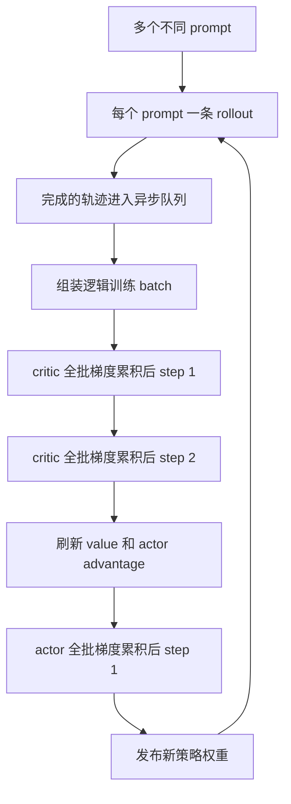

# SAO 的 single rollout、异步偏差与 PPO/GRPO 动机核对

日期：2026-09-23。对象：已阅读并实现过 SAO、现在希望判断算法动机与实现语义的读者。本次只研究文献和读取源码，不修改训练代码、不合并分支、不运行 GPU 实验。

## 1. 先回答最影响判断的两点

**论文中的 single rollout 是每个 prompt 一条轨迹，不是每条轨迹完成就立刻进行一次 optimizer step。** SAO 摘要直接定义为
“using one rollout per prompt”。§4.1 明确写 batch size 128、group size 1，以及 “performing two
value model updates per
batch”。因此，128个不同prompt各取一次，组成一个训练batch，再critic更新两次、actor更新一次，与论文这一层语义相容。\[S1\]

**保存真实采样时的逐token logprob，足以描述不同版本共同生成的行为过程；但单token importance ratio不等于完整的轨迹分布校正。**
前者是概率记录问题，后者是估计器问题。SAO有偏差—方差—计算成本取舍，但不能从“多版本生成”或“batch较大”直接推出“bias很大、variance很小”。

你的合理质疑应保留为：SAO相对于已有异步PPO、异步GRPO和critic-free
single-rollout方法，能否在**计入critic和预训练成本的相同预算下**提供更好结果？目前读到的证据不支持把“PPO天然优于异步GRPO”作为一般结论。

## 2. 来源与版本边界

| 标记 | 一手来源                                                                                                                      | 本次查阅边界                                                       |
| ---- | ----------------------------------------------------------------------------------------------------------------------------- | ------------------------------------------------------------------ |
| S1   | [SAO](https://arxiv.org/html/2607.07508v1)                                                                                    | 固定v1；本次成功重新获取HTML；§3、§4.1–4.5、附录A/B                |
| S2   | [Molt](https://arxiv.org/abs/2607.21653v2)                                                                                    | v2，2026-09-16修订；§4.3–4.5                                       |
| S2c  | [Molt仓库](https://github.com/NVIDIA-NeMo/labs-molt/tree/95c448f93b446f37a7f33c32c19038eaf8645b36)                            | 固定commit；论文之后新增的实现能力单独标记                         |
| S3   | [AReaL](https://arxiv.org/abs/2505.24298v5)                                                                                   | v5，2026-03-02；§5.1/5.2、附录B.1/C.4/D                            |
| S4   | [IMPALA](https://arxiv.org/abs/1802.01561v3)                                                                                  | v3，2018-06-28；§4 V-trace                                         |
| S5   | [Asynchronous RLHF](https://arxiv.org/abs/2410.18252v3)                                                                       | v3，2025-04-26；off-policyness与loss robustness实验                |
| S6   | [VAPO](https://arxiv.org/abs/2504.05118v3)                                                                                    | v3，2025-04-11；value pretraining、双lambda、长度自适应GAE         |
| S7   | [Single-Stream Policy Optimization](https://arxiv.org/abs/2509.13232v2)                                                       | v2，2025-09-23；persistent KL-adaptive value tracker               |
| S8   | [FlashREINFORCE作者仓库/论文](https://github.com/yifanzhang-pro/FlashREINFORCE/tree/a1ebe22c6951e40b7be83395f9f15e9b41ab36dc) | 2026年9月作者公开材料，固定commit；不视为独立复现或与SAO的公平对照 |

原始HTML/PDF、抽取文本及Molt代码快照保存在
[本次证据目录](/data_storage/yl_test/lgx/data-1/code/_artifacts/AReaL/sao-theory-research-20260923)。文献分数均为作者报告，不是本项目复跑结果。

本地SAO事实固定到 **`codex/sao-integration@e6da977d973cf6589d87fb2378e23d2ac38b5612`**。另一个目标分支
`codex/sao-math` 本次读到 `b3c91e33`，尚不包含该候选祖先；不得将目标目录中的 `sao_ppo.yaml` 当成已验收SAO的配方。

## 3. Group、batch、minibatch、microbatch分别在控制什么

| 概念                            | 控制的问题                                     | 已验收SAO候选                                   |
| ------------------------------- | ---------------------------------------------- | ----------------------------------------------- |
| group size / samples per prompt | 同一个问题采几条回答                           | `gconfig.n_samples=1`                           |
| prompt/global batch             | 一次逻辑训练批包含多少问题/轨迹                | 示例128个prompt；短程验收覆盖为8个prompt        |
| PPO minibatch                   | 对同一逻辑批拆多少次独立优化器更新             | actor/critic均为`ppo_n_minibatches=1`           |
| engine microbatch               | 一次优化器更新的数据分几次forward/backward处理 | Qwen3.5每次一条真实序列；期间累积梯度           |
| data parallel                   | 同一次全局更新分布在多少个rank上算             | 四个训练rank共同贡献梯度，不是四次独立actor更新 |
| critic update frequency         | actor一次更新前，critic完整优化几遍            | 两次，各自也有microbatch累积                    |

源码入口：[SAO YAML](/data_storage/yl_test/lgx/data-1/code/_worktrees/AReaL/codex-sao-integration/examples/math/gsm8k_sao.yaml:32)、[actor minibatch循环](/data_storage/yl_test/lgx/data-1/code/_worktrees/AReaL/codex-sao-integration/areal/trainer/ppo/actor.py:524)、[FSDP先forward/backward再step](/data_storage/yl_test/lgx/data-1/code/_worktrees/AReaL/codex-sao-integration/areal/engine/fsdp_engine.py:921)、[C→C→刷新value→A](/data_storage/yl_test/lgx/data-1/code/_worktrees/AReaL/codex-sao-integration/areal/trainer/ppo/update.py:105)。

图中的“进入训练队列”与“立即optimizer.step”不是同一件事。SAO Figure
2/§3.2有“轨迹完成即可供训练”的表述，容易被读成后者；§4.1的batch128消除了这个歧义：它移除的是**同prompt兄弟轨迹的凑组门槛**，不是所有batch聚合。

例如短程验收的全局8条轨迹，4个rank每个拿2条。每rank依次处理两个单序列microbatch；汇总这8条的actor梯度，只做一次actor
step。critic执行这样的完整过程两遍。`num_micro_batches=2`不表示每个microbatch里两条序列。

### 梯度累积会不会降低“精确度”

固定参数、样本、mask、loss和正确的全局分母时：

$$
g_B(\theta)=\frac{1}{N}\sum_{m=1}^{M}\sum_{t\in\mathcal B_m}\nabla_\theta\ell_t(\theta).
$$

把求和分成几次backward再step，在数学上不改变这个batch梯度。不同microbatch长度必须使用同一个全局有效token分母；不能把各microbatch的均值再无权平均。Molt
§4.5也明确规定整个distributed optimizer window使用相同action-token分母，并说明对microbatch/DP重分块不变。\[S2\]

浮点加法顺序、随机层、packing边界或错误归一化可能带来实际差异；它们需要工程验证，不是batch>1的必然统计代价。我们的Qwen3.5单序列microbatch限制正是为了保护recurrent边界。

如果每个microbatch都step，后一个梯度是在新参数上求的，Adam状态也推进了：这已经换了优化算法和更新预算，不再是同一batch更新的另一种实现。

大batch在独立同分布、同一估计目标的简化条件下通常降低梯度估计方差，提高Monte
Carlo精度。它可能减少固定样本预算下的更新次数、改变响应速度和优化表现，但不能笼统叫“精确度降低”。更大batch可能增加等待的墙钟时间，却同时降低权重发布频率；以“版本数”衡量的policy
lag未必更大。

## 4. rollout policy到底是什么：不需要把old1…oldN平均成一个网络

令$h_t$为包含prompt、此前动作和工具观察的完整历史，$k_t$为生成第$t$个action token时所用的版本。真实行为概率是

$$
\mu_t(a_t\mid h_t)=\pi_{k_t}^{\mathrm{sampling}}(a_t\mid h_t).
$$

上式是snapshot与历史计算一致时的写法；若KV
cache、路由或切换过程也影响采样，应把这些信息纳入扩展历史，将$\mu_t$理解为实际采样器的条件分布，而不强行认作某个checkpoint重新forward的结果。

采样引擎当时就能输出所选token的$\log\mu_t$。保存这个数，训练时再在**同一个历史**上计算当前策略概率：

$$
\rho_t=\exp\bigl(\log\pi_\theta(a_t\mid h_t)-\log\mu_t(a_t\mid h_t)\bigr).
$$

这正是SAO Eq.2直接读取rollout logs的做法。\[S1\] “rollout
policy”在这里是生成该token的行为分布，未必对应一个贯穿整条轨迹的checkpoint。

例子：第一个token来自v10，其行为概率0.1；第二个token来自v12，其行为概率0.4。当前策略在相应历史上的概率分别为0.2和0.2，则两个ratio为2和0.5。无需保存v10/v12完整权重，也不需要把两个网络平均起来重新算分母。

条件于实际历史和版本切换过程，行为轨迹概率仍可按链式法则分解为各token条件概率之积。相同环境转移机制下，完整轨迹IS使用各action概率比的乘积；若版本更新依赖额外历史，形式化时将其纳入扩展历史。AReaL
§5.2 Proposition 1及附录D专门给出了混合版本生成的行为策略构造。\[S3\] 这不等于任意一个现存单checkpoint都能表示它。

### 实现中必须核对的条件

1. 保存采样当时的概率，而不是训练时用某个“最近old模型”重新计算并冒充它。
1. token、history、logprob一一对应；工具观察和padding不误当成模型action。
1. temperature、top-p/top-k、logit处理与logprob语义一致；nucleus采样还可能破坏full-policy
   IS所需的support覆盖。不能把未经验证的raw-softmax logprob自动认定为截断后采样概率。
1. serving与training实现的数值/路由差异应另行审计，尤其MoE routing、量化和KV缓存。
1. 模型更新与请求中断/续生成边界必须明确；不能一边原地替换权重，一边无法说明返回token由什么计算产生。

**本地证据边界：** e6候选从SGLang读取`output_token_logprobs`，续生成时拼接原始token
logprobs；每个HTTP片段发出前读取`request_version`，将同一个标签赋给这个片段的所有token。[remote_inf_engine.py](/data_storage/yl_test/lgx/data-1/code/_worktrees/AReaL/codex-sao-integration/areal/infra/remote_inf_engine.py:970)。XCCL权重更新请求带`abort_all_requests=True`，中断后保留prefix续生成。[sglang_remote.py](/data_storage/yl_test/lgx/data-1/code/_worktrees/AReaL/codex-sao-integration/areal/engine/sglang_remote.py:248)。

因此，旧验收证明的是**后端返回概率和请求版本标签在数据流中未被改写**；不是独立证明后端内部每个token的真实weight-version身份。本次未专门跑强制中途切换、多版本混合轨迹的逐token重算一致性测试。已验收配置temperature=1、top-p=1降低了采样变换的歧义，但不能据此宣称任意backend配置都已合格。

## 5. 真正的bias来自哪些地方

### 5.1 单token IS只校正给定历史下的action分布

对任意给定历史上的函数$f$，在support条件满足时：

$$
\mathbb E_{h\sim d_\mu,a\sim\mu(\cdot\mid h)}[\rho(h,a)f(h,a)]
=\mathbb E_{h\sim d_\mu,a\sim\pi_\theta(\cdot\mid h)}[f(h,a)].
$$

右侧仍然是$d_\mu$，不是当前策略的历史分布$d_{\pi_\theta}$。此外，旧策略后续动作产生的return不自动变成当前策略的$Q^{\pi_\theta}$。要精确校正完整目标，通常还涉及prefix/trajectory权重或更专门的off-policy
return方法；长轨迹乘积的方差可能非常大。

一个反例：旧策略只有10%概率到历史A，当前策略有90%；在A处的下一动作分布相同，因此该token的ratio=1。只校正当前token不会把A的出现频率从10%改为90%。把batch增加到无限大，只会更准确地估计这个仍按旧历史分布加权的量。

SAO的token-level DIS不是完整轨迹IS，也不是无偏on-policy policy-gradient的普遍证明。

### 5.2 DIS的丢弃会主动改变估计目标

SAO数学配方的Eq.3为：

$$
f(\rho)=\rho\,\mathbf 1\{0.7<\rho<6.0\}.
$$

区间外是直接mask掉，而不是把ratio夹到边界继续贡献；与standard PPO按advantage正负选择的surrogate clipping不同。\[S1
§3.1\]

即便没有历史分布问题，mask后一般也有

$$
\mathbb E_\mu[\rho\mathbf 1_{\mathrm{keep}}f]\ne\mathbb E_\pi[f].
$$

其目的在于限制极端失配样本的影响，代价是放弃部分校正/学习信号。token
ratio都“不过界”也不保证整条轨迹接近：例如许多1.02相乘也会形成很大的乘积。SAO正文承认接受“a controlled degree of off-policy
bias”，但本次读取未找到可据此断言具体任务偏差大小的定量上界。

### 5.3 critic/GAE和采样选择也有独立影响

- 不准确的**action-independent baseline本身**，在适当的on-policy Monte
  Carlo估计里并不自动引入bias；它主要影响方差。不能把“critic不准”直接等同于“所有policy gradient必然有偏”。
- 但实际bootstrapped value、有限lambda
  GAE、旧策略return、目标变化及截断处理会引入另外的近似。critic多训一次不保证消除这些问题，也可能更贴合旧数据。
- completion-first调度、丢弃过期轨迹、动态过滤等还可能改变prompt/长度/难度的样本分布；action概率比不能自动校正所有这种选择效应。

所以“偏差来自多个old版本，所以靠batch压方差”不是准确归因。更合适的是：**异步改变数据分布；局部IS做部分校正；mask限制失配影响并引入选择偏差；critic和batch各自控制部分噪声。**
偏差、方差究竟多大需测量。

在固定估计目标、独立样本的简化模型下可写为

$$
\operatorname{MSE}(\bar g_B)=\|b\|^2+\operatorname{tr}(\Sigma)/B.
$$

增大batch不会把$b$消掉；异步样本相关时还要考虑协方差，不能机械套用$1/B$。

## 6. 为什么考虑critic，为什么又不能据此宣布PPO更优

把四个设计轴分开，很多争论就清楚了：

| 设计轴                   | 选择例子                                                             |
| ------------------------ | -------------------------------------------------------------------- |
| 每prompt采样数           | 单样本、组采样                                                       |
| advantage/baseline       | learned critic、组内均值/RLOO、历史tracker、全局baseline             |
| 策略更新与off-policy处理 | PPO clip、decoupled PPO、Direct DIS、V-trace式targets、sequence gate |
| 调度                     | 同步batch、异步completed-group、异步single-trajectory                |

PPO-style loss不必配learned
critic；异步也不必是PPO。AReaL所读版本附录B.1明确写主实验禁用critic/reference，并在C.4补充RLOO；不能把它所有“PPO”实验读成经典actor-critic。\[S3\]

**SAO动机成立的部分：** 对真实不可重复的用户/环境反馈，每个prompt确实可能只有一次轨迹；标准GRPO无法直接获得同prompt组内baseline。learned
$V(h_t)$提供跨任务泛化、随prefix变化的baseline和更细的时序估计。对可重复但很昂贵、时长长尾的agent任务，去掉同组等待也能改善调度自由度。相同128条rollout预算下，G=1可覆盖128个prompt，G=8只覆盖16个，这是明显不同的训练分配。

**你的成本质疑成立：** critic有forward/backward、optimizer
state、通信和预训练成本，K=2又增加工作；不准确的critic还会引入耦合和bootstrapping问题。相反，GRPO通常不需要learned
critic，但会花同prompt重复rollout、维护group完整性，并可能遇到全同reward组无有效相对信号。prompt重复还可能享有prefix-cache收益，因此也不能按组数直接算净加速。

**结论范围：**
group-free在调度依赖上通常更简单；这不等于其统计off-policy容忍度必然更高，更不等于总GPU成本更低。是否更好要取决于critic质量、rollout/训练成本比例、轨迹长尾、环境能否重复及评测目标。作者是否因为已有PPO
infra而选择此路，公开材料不足以确认，不能当成事实。

## 7. 先前工作怎样稳定异步训练

| 工作                     | 主要稳定化思路                                                                         | 与SAO的关系及限制                                                                                               |
| ------------------------ | -------------------------------------------------------------------------------------- | --------------------------------------------------------------------------------------------------------------- |
| IMPALA / V-trace \[S4\]  | behavior/target分离，用截断IS系数构造多步value target                                  | 异步actor-critic的老路线；不是PPO，也不只是actor loss乘一个ratio；截断参数分别影响target fixed point和trace方差 |
| Asynchronous RLHF \[S5\] | 系统地改变off-policyness，比较PPO、RLOO、Online DPO的鲁棒性                            | 说明稳定性已被研究；该论文主要发现Online DPO更耐off-policy，不能说它证明PPO最适合异步                           |
| AReaL \[S3\]             | 限制staleness，分开真实behavior和近期proximal policy，围绕proximal做clipping           | 与SAO最直接的异步PPO-style目标对照；有算法/lag消融，不是只做吞吐                                                |
| VAPO \[S6\]              | value预训练、双lambda、长度自适应GAE、token loss等                                     | 长CoT actor-critic稳定化的重要前序；本身不是专门解决任意异步lag的定理                                           |
| SPO \[S7\]               | 每prompt单样本，以persistent KL-adaptive tracker替代组内baseline                       | single-stream不必用大critic网络；也不是自动完成完整off-policy校正                                               |
| Molt \[S2/S2c\]          | completed-group异步组批；保留token behavior概率；可配置IS mask/clip与sequence过滤      | 框架支持GRPO、RLOO、REINFORCE++、GAE/PPO等，不能与SAO作为两个同层“算法”直接对立                                 |
| FlashREINFORCE \[S8\]    | critic-free单rollout，batch baseline、token IS、sequence trust region、sample-mean更新 | 2026年9月作者公开的另一条路线；不是SAO已被公平击败的证据，也不应混同于Molt v2论文全部能力                       |

AReaL的核心区别可以写成（省略状态参数）：

$$
\frac{\pi_{\rm prox}}{\mu}
\min\left(\frac{\pi_\theta}{\pi_{\rm prox}}\hat A,
\operatorname{clip}\left(\frac{\pi_\theta}{\pi_{\rm prox}},1-\epsilon,1+\epsilon\right)\hat A\right).
$$

未裁剪分支的两个ratio相乘就是$\pi_\theta/\mu$；但clipping的中心是近期proximal
policy，不能在带clip的整体式子里简单约掉。AReaL以当前每次更新前的参数重算proximal
logprob，SAO直接使用behavior比率加双侧mask，节省这次额外推理。**二者不仅是“old checkpoint存不存”的工程差别，而是不同的更新约束。**
\[S1/S3\]

V-trace则把$\rho_t$及trace系数$c_t$用进多步TD目标，处理value/return层的off-policy问题；它与SAO的actor
token-mask不能互称等价。

Molt §4.3原文明确：“The trainer assembles batches from completed groups while further
rollouts remain in flight”。它不必等整个系统所有轨迹结束，只需保留组估计器需要的组内依赖；partial
rollout在refit后继续时保存每个action token原始logprob。§4.5也明说mask/clipping是bias与失配样本影响之间的取舍。\[S2\]

## 8. SAO的实验到底支持了多少优势

SAO v1 Table 1/2和§4.2给出了有价值的实证：GRPO+DIS明显优于原GRPO，完整SAO又优于GRPO+DIS。例如：

| 作者报告的方案 | AIME2025 | BeyondAIME | SWE-Bench Verified |
| -------------- | -------: | ---------: | -----------------: |
| GRPO + DIS     |     93.5 |       70.8 |               27.0 |
| SAO            |     97.3 |       74.8 |               29.8 |

这些是论文特定Qwen3-30B-A3B/agentic设置中的结果。\[S1\] 其价值不应被说成“只是换个名字，没有任何证据”；但也不能升格成PPO普遍胜过GRPO。

- DIS本身也改善GRPO，说明至少一部分收益不是critic或single-rollout独占。
- 相同128条轨迹下，SAO有128个prompt，GRPO为16个prompt×8；这是一项实际设计优势，也意味着比较同时改变了prompt覆盖、baseline和组等待，不是只隔离“有无critic”。
- K=1与K=2、full-value与frozen-attention消融支持组件在该配方中的作用；不意味着K=2对所有critic和预算普遍最优。
- Table 4中的vanilla VAPO是不带DIS的；它不能替代“同一数据/lag/预算下，调好参数的decoupled PPO + 合理value训练”对照。
- 本次论文未提供足以判断“计入critic预训练与两次更新后，统一GPU小时预算仍普遍最优”的全面对照，也没有与新近FlashREINFORCE的同条件比较。

因此我对motivation的判断是：**它作为适配长尾agent反馈的实用组合有依据；把“single rollout + actor-critic
+异步”本身当作全新范式，或者由此推断相对所有异步PPO/GRPO的全面优势，证据不够。** 更可辩护的贡献是Direct
DIS与value训练配方在其agentic任务上的组合效果。

## 9. 对我们项目的实际含义

1. **无需因“batch不是1”改掉现有optimizer频率。**
   这会换成另一个算法。先保持示例n=1、逻辑batch128、每批C2/A1；短程batch8结果只作为机制接通证据。
1. **不要把PPO配方误叫SAO。**
   已验收入口是`gsm8k_sao.py/yaml`；目标目录中的`sao_ppo.py/yaml`是同事PPO工作，即使名字带sao，也不能据此判断SAO是否n=1。
1. **把数学解释与论文直译分开。**
   本项目已确认原始action-token均值、普通MSE、固定target与critic更新后刷新advantage，以及$-\operatorname{sg}(\rho A)\log\pi$的梯度约定。论文Eq.1未显式写stop-gradient；字面求导$-\rho A\log\pi$会多出$(1+\log\pi)$因子，不能称为同一个autograd式子。
1. **当前接受的是dense机制移植，不是论文收益复现。** 我们采用Base
   critic短程冷启动、没有frozen-attention/MoE；这些比“有没有batch”更值得注意。旧验收不能推出critic已学好、长horizon稳定或SAO优于PPO。
1. **要回答优势，后续应另行批准公平实验。** 优先比较相同基础设施上的async GRPO+DIS、group-free
   critic-free、以及SAO；消融保持baseline固定只换DIS/decoupled
   PPO。固定并披露生成token、不同prompt数、actor/critic更新量、critic预训练GPU时、评测预算、lag分布；同时报告reward/准确率、DIS剔除率、ratio尾部、critic质量与有效更新。这里是研究建议，尚未启动这些实验。

## 10. 四个自测：避免再次混淆层次

### 练习一：batch128、每prompt一次，是不是single rollout？

参考答案

是。SAO的single约束group size，不约束optimizer batch
size。128个prompt各一次与16个prompt各八次具有相同轨迹数，但不是相同采样设计。

### 练习二：源码中哪两个位置区分microbatch和optimizer step？

参考答案

e6的`FSDPEngine.forward_backward_batch`在每个microbatch调用backward；`train_batch`在整个调用返回后才执行`optimizer_step`。再对照`PPOActor.ppo_update`的minibatch循环，每次`train_batch`会对应一个优化器step。不要只看变量都叫mb就认定语义相同。

### 练习三：每个token ratio都小于6，是否证明长轨迹几乎on-policy？

参考答案

不能。局部ratio没有直接修正prefix分布；许多小偏离的乘积也可能很大。mask控制部分极端更新，而不是给整条轨迹一个通用无偏或接近保证。

### 练习四：若想检验critic是否值得，为什么只固定batch128不够？

参考答案

还可能改变不同prompt数、生成长度/工具成本、actor更新数、critic两次更新及预训练成本、lag分布。至少需要同时报告质量—生成token和质量—总GPU时曲线，并让对照的IS/staleness控制具有可比性。否则无法区分收益来自更广prompt覆盖、更多训练计算、不同优化目标，还是critic本身。

