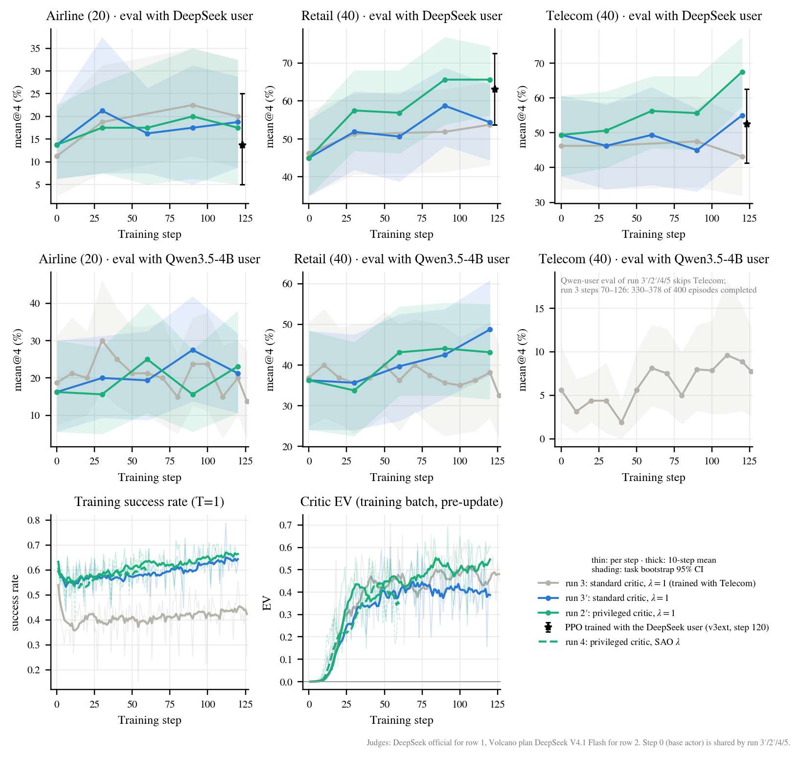

# 10月26日讨论记录：Qwen 用户训练的几个 run，以及要补的 case study

2026-10-26。数据读于 01:57–03:30 PDT；run 4 当时训练到第 60 步左右，还没有评测。图由
[`scripts/figures/plot_qwenuser.py`](../scripts/figures/plot_qwenuser.py)
在开发机上生成，评测和训练日志新增后重跑即可更新。

## 0 先看手里已有的结果

1. **用 Qwen3.5-4B 当用户训练，换 DeepSeek 当用户评测，带剧本 critic 的 run 2′ 比标准 critic 的 run 3′ 好。**
   Retail step 120：65.6 对 54.4，差 +11.3pp \[+1.3, +21.2\]；Telecom（训练里没有）+12.5pp \[+3.7,
   +21.9\]；Airline 无差别。run 2′ 与用 DeepSeek 用户训练的 PPO（v3ext）持平（+2.5pp \[−7.5, +12.5\]）。
1. **但换回 Qwen 用户评测，排名反过来。** Retail 43.1 对 48.8，−5.6pp \[−15.3,
   +3.7\]，单看不显著；两个评测者给出的差值之差（交互）是 +16.9pp \[+2.2, +30.9\]，CI 不含 0。
1. **带剧本 critic 的 EV 更高**：第 101–120 步均值 0.520 对 0.397，差 +0.123 \[+0.070, +0.176\]（按步
   bootstrap）。训练成功率只高 +0.019 \[−0.002, +0.038\]。
1. **Telecom 在 Qwen 用户下训不出东西，已从训练集去掉。** 同一个 step 0 agent，Telecom 在 DeepSeek 用户评测下
   46–49%，在 Qwen 用户评测下 5.6%；Qwen 用户在长对话里不发 STOP，约 45% 的 Telecom episode 撞 200 条消息上限。
1. **这些都还没看过轨迹。** 上面的差异是什么行为造成的、critic 在弱用户下能不能看出 agent 的错误，都没有证据。§5 是要做的 case study。

局限：每个 run 只有一个训练种子；DeepSeek 评测每个 checkpoint 只跑了一次，同一 checkpoint 两次评测最多相差约
6pp；上面做了十余次比较，单个 CI 不含 0 不能当定论。

## 1 思路的转变：为什么放弃 $A = a + \epsilon$

10-22 的出发点：一个 agent 时间步上观测到的 advantage $A$ 里，既有 agent 动作的贡献 $a$，也有用户带来的噪声 $\epsilon$；估计出
$\epsilon$（或直接估计 $a$），就能给 agent 它"本应得到"的 advantage。

结论是这个拆分在我们的设定下做不到，理由有三条（详细推导见 [reflection-20261024 §2](reflection-20261024.md) 和
[m2-additive-vs-multiplicative](m2-additive-vs-multiplicative-20261022.md)）。

**(1) 不可辨识。** 只看对话和结局 reward $R$ 时，"用户错了"、"用户难缠但 agent 没应对好"、"agent
先错了、用户顺着走"能产生同样的数据，$\epsilon$ 没有被数据确定。我们试过的四种做法都是在这里失败的：

| 做法                         | 失败方式                                                           |
| ---------------------------- | ------------------------------------------------------------------ |
| 统一 β（对用户段的 TD 打折） | 最后一次用户回复里混着 agent 自己的错误，β 替 agent 打了折         |
| 规则门控                     | "yes + STOP"之前 agent 的方案常常已经错了，反事实 precision 约 58% |
| judge 门控                   | 把 12.8% 的 agent 失败判给用户；judge 本身也面对同样的不可辨识     |
| 按剧本可靠度加权             | 剧本方差主要反映 agent 的时成时败，不反映用户                      |

导师不接受额外的检测器或 judge（10-21）。这样一来，能补上缺失信息的只剩用户剧本 $z$：它写明了用户想要什么、该怎么表现。

**(2) 线性拆分把要学的东西也拆掉了。** 用户 T=0
时，给定对话历史，用户的回复几乎确定，"实现出来的噪声"期望为零、也很小。剩下的"可预测的不可靠"（这个用户在这种情况下就会提前 STOP）就是目标
$J$（在这个用户下的成功率）的一部分，对 $J$ 无偏的估计碰不到它；不用检测器时，加法修正只能由 critic 的 value 变化构成，每回合取一个数就回到了 β。

**(3) 现象在训练分布里很小。** DeepSeek 用户下 U1（用户在确认处提前 STOP）约 2% 的 episode，U3（偏离目标）约 1%，失败约 92% 是
agent 自己的错。用户错误大的地方是换弱模拟器评测，而不是训练。

**转向：不减去 $\epsilon$，而是让 critic 看到 $z$，再让 critic 的 value 通过 bootstrap 进入 advantage。**
$V(h,z)$ 能把"这个用户会怎样"算进期望，不需要单独估计 $\epsilon$；Baisero & Amato（AAMAS 2022）证明这种
history-state critic 作 baseline 和作 bootstrap 都不引入偏差，偏差只来自 critic 本身的估计误差。但在
$\gamma=\lambda=1$ 时 critic 只是 baseline，只降方差、不改变谁被罚（§3.2），所以要配合 $\lambda<1$。这就是 run 4 /
run 5。

## 2 现在发现的问题

PPO 和 SAO 训练中已经看到的（来源在括号里）：

1. **Telecom 用 Qwen 用户训不动**（[infra-issues §5](../infra-issues.md)、上面的第 4 条）：问题在用户模拟器，不在
   agent。run 3 带着 Telecom 训练，训练成功率 0.39 → 0.44；去掉后的 run 3′ 是 0.55 → 0.64（第 1–10 步 → 第
   101–120 步均值，两者训练集不同，不能直接比）。
1. **结论依赖评测用户。** 同一对 checkpoint，DeepSeek 用户和 Qwen 用户给出相反的排名（第 0 节第 2 条）。Qwen
   用户评测本身噪声也大：同一 checkpoint 两次评测相差 −5.0 / −2.5 / +6.2pp。
1. **Airline 在所有 run 里都不涨**：训练集里需要拒绝或不写库的题占 15.8%，test 里占
   70%（[train-test-coverage](../train-test-coverage/REPORT.md)，backlog #1，未改数据）。
1. **对话变长、撞上下文上限。** SAO 让超过 32K 的 episode 从 4 增到 76（reflection §5.2）；run 2′ 在 Qwen 评测里有
   4/320 条因上下文超限失败，run 3′ 没有。
1. **合规侵蚀**：标准 PPO 下"同意不足"（B5）+14–17pp，agent
   学会的是问得不完整，不是不问（[compliance-erosion](../compliance-erosion-case-study/REPORT.md)）。
1. **Qwen 用户下的轨迹还没有人读过。** 第 0 节的每条结果都只有分数。

## 3 现在的方法：advantage 和 loss 的完整式子

以下按代码和 run 2′ / run 4
实际加载的配置写（`areal/trainer/ppo/gae.py`、`actor.py`、`lambda_fn.py`、`critic.py`、
`areal/utils/functional/functional.py`）。

### 3.1 符号

- 一条 episode 里 agent 生成的 token 记为 $t=0,\dots,L-1$（$L$ 只算 agent 的 token，含 EOS；用户、工具返回和
  prompt 不算时间步，GAE 递推直接跳过它们）。
- $R\in\{0,1\}$ 是 τ² 的结局 reward，放在最后一个 agent token 上；中间 reward 为 0；$\gamma=1$；KL 系数为 0。
- $V_t$ 是 critic 在 token $t$ 处的 value。标准 critic 读对话 $h_t$；带剧本 critic 另外在开头读用户剧本
  $z$（persona、来电原因、已知/未知信息、行为指示，不含 gold 动作和评测字段，`examples/tau2/critic_scenario.py`）。终止后
  $V_L=0$。

### 3.2 advantage

TD 误差 $\delta_t = r_t + V_{t+1} - V_t$，GAE

$$
\hat A_t=\sum_{k\ge 0}\lambda^k\delta_{t+k}
=\lambda^{L-1-t}R+(1-\lambda)\sum_{j\ge 1}\lambda^{j-1}V_{t+j}-V_t .
$$

第二个等号是把 $\delta$ 展开后合并（$\gamma=1$）：token $t$ 的"目标"是 $R$ 和未来 value 的加权平均，$R$ 的权重是
$\lambda^{L-1-t}$。

- **run 2′ / 3′：$\lambda=1$。** $\hat A_t=R-V_t$，critic 只是 baseline。期望梯度和 critic 无关，带剧本
  critic 只能降方差。
- **run 4 / 5：SAO 长度自适应 $\lambda=1-\dfrac{1}{\alpha L}$，$\alpha=1.5$，每条轨迹一个 $\lambda$。**
  第一个 token 上 $R$ 的权重约 $\lambda^{L}\approx e^{-1/\alpha}=0.51$，剩下 0.49 分给未来的 value；越靠后
  $R$ 的权重越大。

critic 的回归目标单独用 $\lambda_{\text{critic}}=1$ 算：$G_t=R$，与 actor 的 $\lambda$ 无关。

actor 用的 advantage 再做 batch 白化：$\tilde A_t=(\hat A_t-\mu)/(\sigma+10^{-8})$，$\mu,\sigma$
是整个 batch 所有 agent token 上的均值和标准差。SAO 论文没有写是否白化，这是本项目的选择。

**数值例子（白化之前）。** 一条失败 episode（$R=0$），$L=3000$，agent 在第 1000 个 token
处写错了库。$\alpha L=4500$，剩余 $n$ 个 token 时 $R$ 的权重是 $e^{-n/4500}$。

| critic 的 value                  | token 0 的 $\hat A$（λ=1 / SAO） | 写错之后 token 1001 的 $\hat A$（λ=1 / SAO） |
| -------------------------------- | -------------------------------- | -------------------------------------------- |
| 看出错误：写错前 0.6，写错后 0.1 | −0.60 / −0.45                    | −0.10 / −0.06                                |
| 看不出：一直是 0.6               | −0.60 / −0.31                    | −0.60 / −0.38                                |

（SAO 一行的算法：token 0 的目标 $=0.51\times0+0.20\times0.6+0.29\times0.1=0.15$，减去 $V_0=0.6$；0.20
和 0.29 是第 1–1000 个和第 1001–3000 个 token 的权重。）

读法：

1. $\lambda=1$ 时两种 critic 对写错之前的 token 罚得一样重（−0.60），这就是"只降方差"。
1. SAO $\lambda$ 加上看得出错误的 critic：写错之后的 token 几乎不罚（−0.06），罚集中在写错之前和写错那一步。
1. SAO $\lambda$ 加上看不出错误的 critic：罚被摊平，写错之前反而罚得更轻（−0.31），写错之后的 token 仍被罚（−0.38）。critic
   错了，bootstrap 就把错误带进 advantage。
1. 写错之前那些本来正确的 token 仍要背 −0.45：$\lambda$ 接近 1，SAO 只能把 credit 往后挪一部分，不能精确定位到写错的那一步。

所以"动态 $\lambda$ + 带剧本 critic 可能就够了"取决于一个可检验的前提：**在 Qwen 用户下，带剧本 critic 的 value 会不会在
agent 出错的地方提前下降，而标准 critic 不会。** 649（DeepSeek 用户）上看到过这个现象：对 agent 自己的失败，带剧本 critic
在结算时剩下的意外是 −0.262，标准 critic 是 −0.455
（[privileged-critic-case-study](../privileged-critic-case-study/REPORT.md)）。Qwen
用户下还没测，§5 的 B 部分测它。

### 3.3 loss

actor（PPO，decoupled 形式）：

$$
\mathcal L_{\text{actor}}=-\frac{1}{N}\sum_{t}w_t\,\min\!\big(\rho_t\tilde A_t,\ \mathrm{clip}(\rho_t,0.8,1.2)\,\tilde A_t\big),
\qquad
\rho_t=\frac{\pi_\theta(a_t)}{\pi_{\text{prox}}(a_t)},\quad
w_t=\frac{\pi_{\text{prox}}(a_t)}{\pi_{\text{behave}}(a_t)} .
$$

- $\pi_{\text{behave}}$ 是采样时推理引擎的策略（异步 rollout，最多落后 2 个版本），$\pi_{\text{prox}}$
  是训练端更新前重算的 log-prob；$w_t>5$ 的 token 直接剔除（mask）。$N$ 是 batch 里 agent token
  总数（token-mean）。
- 每步只有一个 minibatch、一次梯度更新，更新时 $\pi_\theta=\pi_{\text{prox}}$，$\rho_t=1$，clip 从不触发（日志里
  clip ratio 和 approx KL 都是 0）。实际梯度是
  $-\frac1N\sum_t w_t\tilde A_t\nabla\log\pi_\theta(a_t)$。
- 无 KL、无 entropy 项；actor lr $10^{-6}$。

critic（value clip 0.5）：

$$
\mathcal L_{\text{critic}}=\frac{1}{N}\sum_t\max\!\Big((V_t-G_t)^2,\ \big(V^{\text{old}}_t+\mathrm{clip}(V_t-V^{\text{old}}_t,\pm0.5)-G_t\big)^2\Big),
\qquad G_t=R ,
$$

critic lr $10^{-5}$，每步一个 minibatch。EV 的定义 $1-\mathrm{Var}(V-G)/\mathrm{Var}(G)$，在更新前的同一
batch 上计算。

## 4 结果

图：前两行是离线评测的 mean@4（每题多次成功率的平均，agent T=0，用户和 judge T=0），阴影是按题 bootstrap 的 95% CI；第一行用
DeepSeek 官方 `deepseek-flash` 作用户和 judge，第二行用 Qwen3.5-4B 作用户、火山 DeepSeek V4.1 Flash 作
judge（run 3′ / 2′ 两次评测合并，每题 8 次；不评 Telecom）。第三行是训练 batch 的成功率（128 条 episode，T=1）和 critic
EV（更新前），细线每步、粗线 10 步滑动均值。颜色表示 critic（蓝标准、绿带剧本），线型表示 actor $\lambda$（实线 1，虚线 SAO）；灰色 run
3 训练集含 Telecom。黑色星号是用 DeepSeek 用户训练的 PPO（v3ext）第 120 步。run 3 的 Qwen 评测在第 70 步之后每个
checkpoint 只完成了 330–378/400 条（评测被中止），图中只用完成的 episode。run 4 只有训练曲线（进行中）。

**表 1　DeepSeek 用户评测，mean@4（%）**

| checkpoint                     | Airline                   | Retail                    | Telecom                   |
| ------------------------------ | ------------------------- | ------------------------- | ------------------------- |
| step 0                         | 13.8                      | 45.0                      | 49.4                      |
| run 3′ 30 / 60 / 90 / 120      | 21.3 / 16.3 / 17.5 / 18.8 | 51.9 / 50.6 / 58.8 / 54.4 | 46.3 / 49.4 / 45.0 / 55.0 |
| run 2′ 30 / 60 / 90 / 120      | 17.5 / 17.5 / 20.0 / 17.5 | 57.5 / 56.9 / 65.6 / 65.6 | 50.6 / 56.3 / 55.6 / 67.5 |
| v3ext 120（DeepSeek 用户训练） | 13.8                      | 63.1                      | 52.5                      |

**表 2　Qwen 用户评测，mean@4（%），两次评测合并**

| checkpoint                | Airline                   | Retail                    |
| ------------------------- | ------------------------- | ------------------------- |
| step 0                    | 16.3                      | 36.3                      |
| run 3′ 30 / 60 / 90 / 120 | 20.0 / 19.4 / 27.5 / 21.3 | 35.6 / 39.7 / 42.5 / 48.8 |
| run 2′ 30 / 60 / 90 / 120 | 15.6 / 25.0 / 15.6 / 23.1 | 33.8 / 43.1 / 44.1 / 43.1 |

**表 3　配对比较（按题配对 bootstrap，20,000 次）**

| 比较                                               | 差值    | 95% CI           |
| -------------------------------------------------- | ------- | ---------------- |
| DeepSeek 评测，Retail：run 2′ − run 3′（step 120） | +11.3pp | \[+1.3, +21.2\]  |
| DeepSeek 评测，Telecom：同上                       | +12.5pp | \[+3.7, +21.9\]  |
| DeepSeek 评测，Airline：同上                       | −1.3pp  | \[−11.3, +10.0\] |
| DeepSeek 评测，Retail：run 2′ − v3ext              | +2.5pp  | \[−7.5, +12.5\]  |
| Qwen 评测，Retail：run 2′ − run 3′                 | −5.6pp  | \[−15.3, +3.7\]  |
| 交互，Retail：(DeepSeek 差值) − (Qwen 差值)        | +16.9pp | \[+2.2, +30.9\]  |

**表 4　训练端（第 101–120 步均值）**

| run                 | 训练成功率 | critic EV（更新前） |
| ------------------- | ---------- | ------------------- |
| run 3（含 Telecom） | 0.443      | 0.486               |
| run 3′              | 0.638      | 0.397               |
| run 2′              | 0.657      | 0.520               |

**结论**

- 观测：带剧本 critic 在 DeepSeek 用户评测下 Retail、Telecom 都明显更好，在 Qwen 用户评测下不更好；EV 后期高 0.12。
- 推断：$\lambda=1$ 时带剧本 critic 不改变期望梯度（§3.2），两个 run 优化的是同一个目标。所以评测者交互要么来自随机种子（两个 Qwen
  下差不多好的策略，在 Qwen 测不到的行为上各自漂向不同方向），要么来自更低的梯度方差让策略少漂向"Qwen
  不罚、强用户会罚"的方向。现有数据分不开这两种，需要换种子复现。
- 未验证：run 2′ 的哪些行为让它在 DeepSeek 用户下更好；带剧本 critic 在 Qwen 用户下是否在 agent 出错处提前降 value。

## 5 要做的 case study

### A　轨迹对照（CPU，已派给 Codex，pueue 704，不用 GPU、不调 API）

任务目录 `phai:_artifacts/AReaL/codex-sao-math/case-study-qwenuser-20261026/`（`BRIEF.md`，结果写
`REPORT.md`）。问题：

1. Qwen 用户下失败的构成：第一个 epoch 和最后四个 epoch，run 2′ 和 run 3′ 各自的 stop
   reason、轮数、上下文超限，以及只用现有字段（不用 LLM）的失败分类：agent 写错库、漏了 gold 写操作、写对了但库仍不一致、用户在写完前 STOP
   或离开、上下文/轮数上限、infra。
1. run 2′ 的行为和 run 3′ 有什么不同：对话长度、工具调用、写库前的确认、转人工、结束方式。
1. 交互来自哪些题：step 120 的两份评测里，哪些 Retail 题在 DeepSeek 下 run 2′ 赢、在 Qwen
   下不赢，这些题的失败分类在两个评测者下各是什么。
1. 给你读的 20 对轨迹（同一道题，run 2′ 对 run 3′），每对标出决定结局的消息位置和查看命令。

这一步只给事实和阅读清单，不替你下结论。按 10-24 的约定，先自己读、写下判断，再看 Codex 的总结。

### B　critic 能不能在弱用户下看出 agent 的错误（GPU，需要你批准）

run card：

- **问题**：Qwen 用户下，带剧本 critic 的 value 是否比标准 critic 更早在 agent 出错处下降？这是 run 4 方法成立的前提（§3.2
  读法第 2、3 条）。
- **做法**：沿用 649 case study
  的前向脚本（`_artifacts/.../tau2-privileged-critic-case-study-20261021/forward.py`、`analyze_forward.py`）。run
  2′ 和 run 3′ 最后四个 epoch 的训练 rollout（每个 run 约 3,000 条），分别用两个 critic 的第 119
  步权重（checkpoint 已在）前向，同一批数据只换 critic。
- **唯一的变量**：critic 是否读剧本。
- **看什么**：同一道题内成功和失败的可分性（第一个 agent token 前 / 对话中间 / 最后一次 agent→用户边界的 pair AUC）；按 A
  的失败分类，失败 episode 的 value 在哪一轮开始下降，以及结算时剩下的意外 $R-V$；把每条 episode 的 value 序列代入 §3.2 的式子，算
  SAO $\lambda$ 下写错前后 token 的 advantage。
- **预期**：带剧本 critic 对"agent 写错库"一类失败更早下降，对"用户提前 STOP"一类两者都下降得晚。
- **无信息的结果**：两个 critic 下降时机和 AUC 相同。那样 run 4 相对 run 5 不应有优势，"动态 $\lambda$ + 带剧本
  critic"这条线缺少机制支持。
- **成本**：8 张卡约 20–30 分钟（649 的同类前向是 11 分钟），无 API 费用；先由 Codex 改脚本、在 CPU 上做 dry run。
- **时间**：GPU 被 run 4（预计今天 10:30 PDT 结束）、它的评测和 run 5（预计明天 04:15 结束）占满。可以插在 run 4 评测和 run
  5 之间（run 5 晚约半小时开始），或排在 run 5 之后。

### C　之后

run 4 / run 5 的评测出来后，按 [run card §13](../experiments/2026-10-24-qwenuser-no-telecom.md)
预先登记的判断读 2×2 交互，并把评测点补进上面的图。
