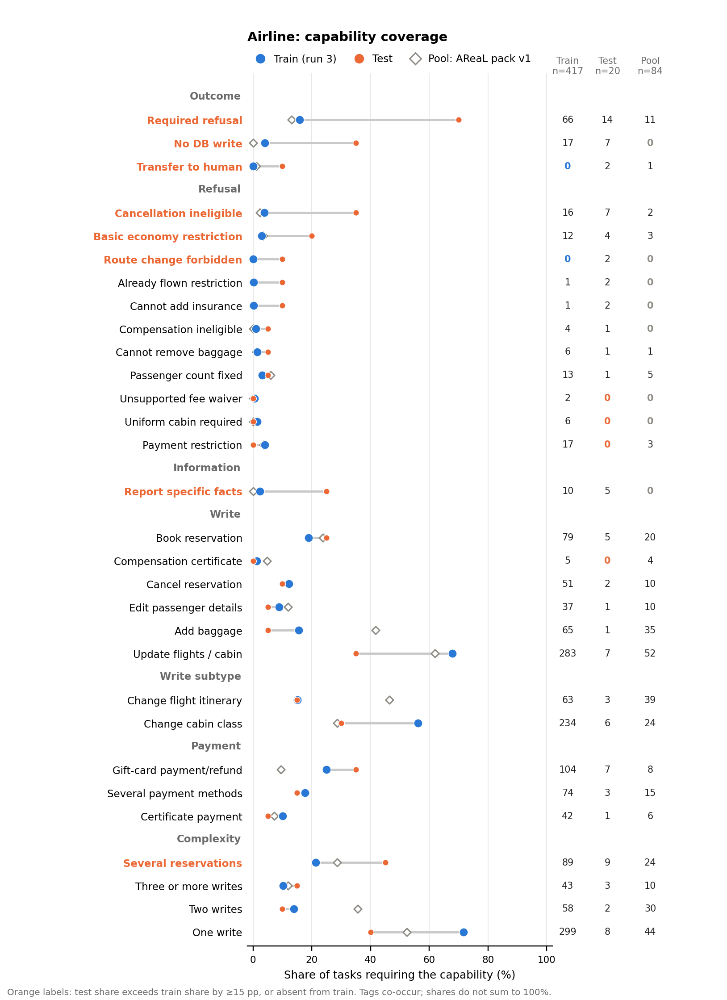
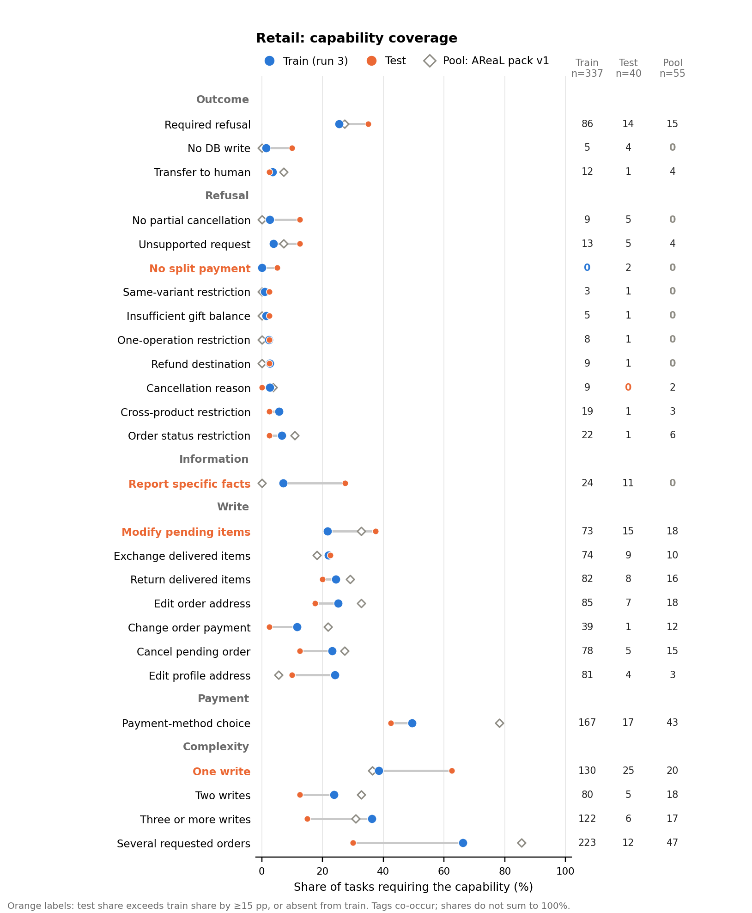
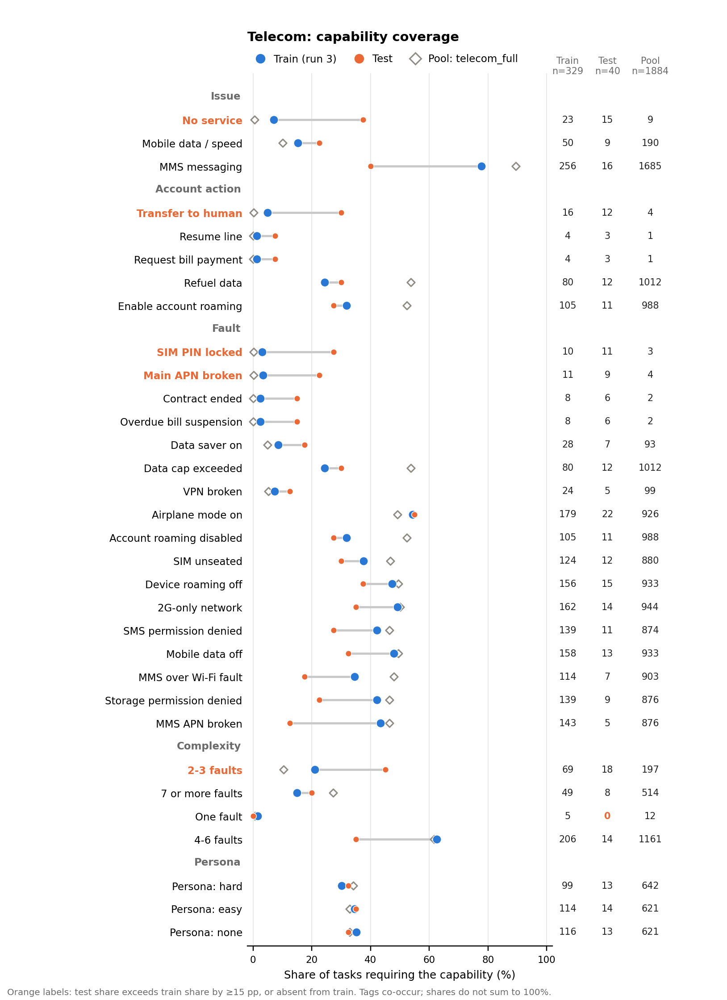

# 训练集与 test 的能力覆盖（2026-10-22）

统计由 Codex 完成（pueue 685，[codex-report.md](codex-report.md)，含每个标签的定义、判定规则、test 例子和人工核对），图由
Claude 绘制（[plot_coverage.py](../scripts/figures/plot_coverage.py)，输入 [coverage_counts.json](../figures/coverage_counts.json)）。
服务器产物：`_artifacts/AReaL/codex-sao-math/tau2-train-test-coverage-20261022/`（逐题标签 `out/tasks.csv`）。

- **当前训练集**：run 3（pueue 680）每个 epoch 实际调度的题。airline 417 = AReaL pack v2 380 + recovered 7 + 官方 train 30；
  retail 337 = pack v2 268 + 官方 train 69（去掉与 test 同用户、gold 写操作完全相同的 5 题）；telecom 329 = 官方 telecom pack v2。
- **test**：eval 实际使用的 fixed-v3 官方 test，airline 20、retail 40、telecom 40。
- **候选池**：airline/retail 画的是 AReaL pack v1 的剩余题，telecom 画的是 `telecom_full` 扣掉 test 同状态题和当前训练题后的剩余。
  其他候选池的数字在 codex-report §2。
- 每行是一种能力：蓝点是训练集里需要该能力的题的比例，橙点是 test 的比例，灰色菱形是候选池；右侧是题数。橙色标签表示 test
  比例比训练集高至少 15pp，或训练集里没有。一道题可以有多个标签，比例不相加。

## 读法

1. **Airline 缺的是"不该执行"和"报告信息"。** 需要拒绝（全部或部分请求）的题，训练 15.8%、test 70%；完全不写库 4.1% 对 35%；
   不符合退票条件 3.8% 对 35%；Basic Economy 不能改 2.9% 对 20%；向用户报告具体信息 2.4% 对 25%；转人工、禁止改航线在训练里是 0。
   训练集反过来偏重改舱位（56% 对 30%）和只有一次写操作的题（72% 对 40%）。
2. **Retail 的缺口小一些。** 报告具体信息 7.1% 对 27.5%，修改待发货商品 21.7% 对 37.5%，不能部分取消 2.7% 对 12.5%，不能拆分支付
   训练 0、test 2 题。训练集偏重多订单的题（66% 对 30%）。
3. **Telecom 缺的是无服务类故障。** 无服务 7.0% 对 37.5%，SIM PIN 锁定 3.0% 对 27.5%，主 APN 损坏 3.3% 对 22.5%，转人工 4.9% 对 30%；
   训练集 78% 是 MMS 题（test 40%）。之前"训练里 0 道充流量"的结论只适用于旧的 249 题 pack，当前 329 题 pack 已有 80 道。
4. **现有候选池补不上大部分缺口。** AReaL v1 的剩余题几乎没有拒绝、不写库、报告信息类题，而且 v1 是被 v2 淘汰的旧数据，有已知
   gold 错误。`telecom_full` 剩余 1884 题里，无服务只有 9 道、SIM PIN 锁定 3 道：官方题池本身就少。所以 airline/retail 的拒绝和
   信息报告题、telecom 的无服务题，需要新构造，并配上能检查这些行为的评分（ACTION / NL / COMMUNICATE），只靠 DB hash 检查不出
   "拒绝对了"或"信息报对了"。
